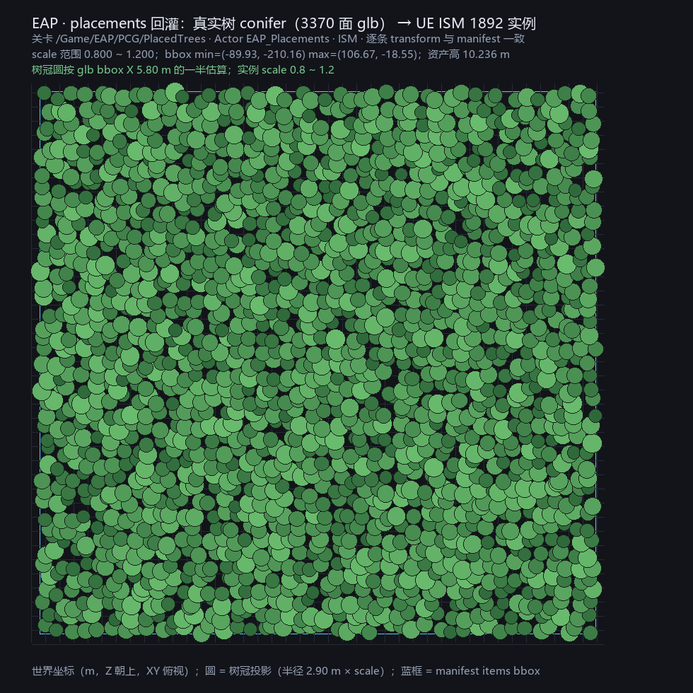
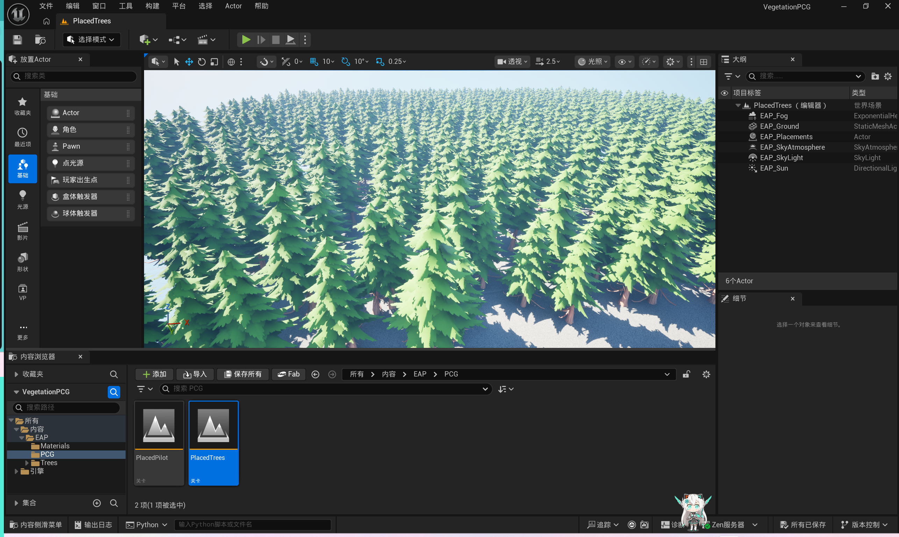

# 多引擎资产管线系统 · Engine-Agnostic Asset Pipeline

> 项目代号：`Engine-Agnostic Pipeline`（下称 EAP）
> 定位：前端 PCG + AIGC 生成 → Python 中台（格式中转 + 合规审查）→ UE5 / Unity 双端消费。
> **当前进度（v1.12.1，2026-11-24）**：阶段一 6 条**全部闭合**（含法线 sRGB 两端 Inspector 截图）；Layer1 数据出口 + 200×200 m（1,892 实例）+ UE ISM 落位 + 换真实树 glb + 材质规范化/贴图三档/roughness 贴图；**Unity 消费端全链路**（模型/贴图/Prefab + 1,892 实例落位 + Collider + 4 级 LOD）；**双端逐实例对账**（1,892 条，maxPos 0 / maxYaw 0 / maxScale 1e-6）与**三段性能表**、**双端 LOD 4 级**均已入库并带断言。现行门槛：`--multi` 13 / `--real-multi` 20 / `--with-compile` 21 / `--unity-check` 4 / `--unity-placements-check` 4 / `--parity-check` 4 / `--lod-check` 4。

## 一、这个项目在作品集里的位置（先读这段）

| 问题 | 结论 |
|---|---|
| 和 NO.01（V3 资产智能管线）什么关系 | **同一条线的下一代**，不是新项目：NO.01 是"单引擎 + 规则/AI 分类"，EAP 是"跨引擎 + PCG 生成 + 合规拦截"。网站**不新增第 10 张卡**（基线审刚要求精简到 5 卡 + 1 横排），改为 NO.01 卡内的版本演进叙事 |
| 补的是哪个缺口 | 四家 AI 基线审一致排第 1 的 **PCG 资格级缺口**（Layer 1），顺带补 ①引擎内工具（Layer 4）与 ⑤取舍沟通（跨引擎架构决策） |
| 不做什么 | 不做 Layer 5 的 VFX/HLOD（加分项，不是资格项）；Unity 端只做最小可验证（材质 + Prefab + Collider），不做 Unity 全套工具 |

## 二、目录

```
Engine-Agnostic Pipeline/
├─ README.md                      ← 本文件
├─ docs/
│  ├─ manifest-spec.md            ← manifest 字段规范（v1.2）+ 引擎映射表 + 坑
│  ├─ phase1-acceptance.md        ← 验收：阶段一 6 条 + Layer1 链路 11 条
│  ├─ tree_asset_requirements.md   ← 树资产采集要求（给采集会话的硬门槛）
│  ├─ pcg_forest_pilot.json       ← Layer1 导出证据：10 节点图参数 + 1892 条散点（cm）
│  ├─ placed_pilot.json           ← 引擎 Cube 落位证据：1892 条落成 UE ISM + 读回 transform
│  ├─ placed_tree.json            ← 真实树落位证据（同上格式，网格换成 conifer.glb）
│  └─ placed_verify.json          ← 新进程重载关卡读回证据（证明持久化）
├─ schemas/
│  ├─ manifest.schema.json        ← JSON Schema（v1.2：placements / engine_native / Unity.modelPath / textures.source）
│  ├─ manifest.example.json       ← 两个资产的完整示例（v1.0 结构，v1.1 向后兼容）
│  └─ pcg_manifest.json           ← 由散点生成的 manifest v1.1（1 资产 + 1892 实例）
├─ ue/Content/Python/
│  ├─ consume_manifest.py         ← UE5 消费端（读 manifest → 母材质/MIC → 贴图 → 碰撞 → placements 统计）
│  ├─ pcg_export.py               ← Layer1 出口：PCG 图参数 + 生成实例 → 散点 JSON（只读）
│  └─ place_manifest.py           ← Layer1 回灌：placements → UE ISM 实例（落位；glb 走无头 Interchange 导入）
├─ unity/Editor/
│  └─ ManifestImporter.cs         ← Unity 编辑端（读同一份 manifest → Material → 贴图 → Prefab；另有 VerifyFromArgs 读回）
├─ tools/
│  ├─ validate_manifest.py        ← 中台侧轻量校验（结构 + 2 的幂 + 通道 + 单位 + v1.1 placements）
│  ├─ pcg_to_manifest.py          ← 散点 JSON → manifest v1.1（cm→m，1 网格 = 1 asset + N placements）
│  ├─ tree_to_manifest.py         ← 真实树 glb + 散点 → manifest v1.2（双端；不信任 sidecar，自己解析 GLB 复算）
│  ├─ glb_to_fbx.py               ← Blender 无头 glb → fbx（Unity 用；X 预镜像 + FBX_SCALE_ALL + 内嵌贴图）
│  ├─ run_pcg_chain.py            ← 一条命令跑完整条 Layer1 链（7 步 / 4 次无头 UE）+ 9 条断言；--multi 13 条 / --real-multi 20 条（--with-compile 21 条）；--unity-check 4 条；--tree 16 条为历史链路
│  ├─ draw_placements.py          ← 从读回 transform 画俯视图（方块 / 树冠圆两种标记）
│  ├─ test_validator.py           ← 校验器 9 条负例（拦截 9/9）
│  └─ test_gui_smoke.py           ← GUI 冒烟（12/12）
└─ assets/                      ← raw/trees/*.glb（不入库）、raw/trees/fbx/*.fbx（Unity 用，入库）、eap_textures/*.png（glb 内嵌贴图导出，入库）
```

## 三、阶段一怎么跑

**1. 造一份 manifest**

```bash
python tools/validate_manifest.py schemas/manifest.example.json
# 期望：OK assets=2 warnings=0 errors=0
```

**2. UE5 端（编辑器内 Python，先 dry-run）**

```python
# 编辑器菜单 Tools → Execute Python Script，或在 Output Log 的 Cmd 里：
import sys; sys.path.append(r"<repo>/ue/Content/Python")
import consume_manifest
consume_manifest.run(r"<repo>/schemas/manifest.example.json", dry_run=True)   # 只打印将做什么
consume_manifest.run(r"<repo>/schemas/manifest.example.json", dry_run=False)  # 真跑
```

**3. Unity 端**

```
菜单 Tools → EAP → Import Manifest…  → 选同一份 manifest.example.json
（或命令行：Unity -batchmode -executeMethod EAP.ManifestImporter.ImportFromArgs -eapManifest <path>）
```

**4. 界面（阶段一 GUI 壳）**

```bash
python run.py        # 或 python -m gui.app；暗色三栏 + 拖放区 + Toast
```

## 三之二、Layer 1 数据出口 + 扩地块（v1.1，一条命令）

**背景**：Layer 1 原先是 2026-10 的 UE PCG 手工试点（`D:\UE_Projects\VegetationPCG`，UE 5.7，
`/Game/PCG_ForestScatter`，用 `/Engine/BasicShapes/Cube` 方盒子替树，19 个实例）。
2026-11-22 分两步：① 数据出口接到中台（密度 `0.01 → 0.1`，实例 **19 → 233**）；
② **地块扩到 200×200 m**（密度 `0.1 → 0.05`，实例 **233 → 1892**，名义 2000、实际 1892 = 94.6%）。

```
UE PCG 图（10 节点：GetLandscapeData → SurfaceSampler → TransformPoints → StaticMeshSpawner
           + 5 个用户参数节点 + 1 个 AttributeMathsOp）
   ↓ pcg_export.py           只读：图参数 + 1892 条实例 transform（uu = cm）
docs/pcg_forest_pilot.json    （1189 KB）
   ↓ pcg_to_manifest.py      cm→m；1 个网格 = 1 个 asset + placements[1892]（不为每实例造资产）
schemas/pcg_manifest.json    （manifest v1.1，626 KB）
   ↓ validate_manifest.py    errors=0
   ↓ consume_manifest.run(dry_run=True)   读到 placements，统计 1892
```

```bash
python tools/run_pcg_chain.py --expect-span-m 200    # 四次无头 UE（各约 13-15s）+ 两次纯 Python；7 步 9 条断言
# 期望末行：CHAIN PASS points=1892 assets=1 placements=1892
```

**改体积 / 密度（必须在真实编辑器里做）**——两个坑都是 2026-11-22 实测：

1. **无头不能重生成 PCG**：`PCGComponent.generate()` 在 `-unattended -nullrhi` 下报
   `Internal Error - ObjectInstance is null!`；带 RHI 的 `-unattended` 也生成不了（233 → 233）。
2. **旧 PCG 组件可能和 actor 脱钩**：这个工程原 `PCG Component` 处于 `generated=False`、
   Details 里 `图 None / PCG组件 None` 的坏状态，`generate()` 和 Details 的生成按钮都无效（点了没反应）。
   解法：**新建一个 PCGVolume → `set_graph()` 挂同一张图 → `generate(True)`**，一次生成 1892 个实例。

体积按米换算：brush 基准 2 m，原 actor scale `25/25/10` = 50×50×20 m；放大到 200 m 用
`actor scale 99.98 / 97.675 / 10`（**Z 保持 20 m**——把 Z 也非均匀放大 150 倍会让实例被拉长、沉到地面以下，
2026-11-22 踩过）。落位 bbox 实测 **196.6 × 191.6 m**（边缘点没采到，< 200 m 属正常）。

导出文件同时是**图参数的原始证据**（`graph.nodes[*].props`）：`points_per_squared_meter=0.05`、
`point_extents=[50,50,50]`、`point_steepness=1.0`、`absolute_rotation=True`、`offset_min/max=±[100,100,50]`、
`scale_min/max=[0.8]/[1.2]`、`uniform_scale=True`、`seed=-1506168781`、`StaticMeshSpawner` 网格 `/Engine/BasicShapes/Cube`。
这比截图更可核对：面试被问"你图里到底怎么配的"，直接翻 JSON。

> **关于数量**：PCG 体积实测 **200×200 m（39997.7 m²）**，0.05 点/m² → 名义 2000、实际 **1892**（94.6%）；
> 上一轮 50×50 m + 0.1 → 名义 250、实际 233（93%）；最早 0.01 → 名义 25、实际 19（76%）。
> 偏差都来自网格量化 + `looseness 0.8`，不是丢数据。

## 三之三、placements 落位（回灌）：manifest → UE ISM 实例

前面三之二证明"PCG 生成能变成 manifest"；这一格证明**反过来也能**：拿 manifest 里的 `placements[1892]`
在 UE 里真的落成 1892 个 ISM 实例，并验证坐标/旋转/缩放一条不差。

```
schemas/pcg_manifest.json（placements 1892 条，m / deg）
   ↓ place_manifest.place()     清空 → 逐条 add_instances(世界坐标) → clear/重建可重复跑
/Game/EAP/PCG/PlacedPilot        专用关卡：1 Actor + 1 InstancedStaticMeshComponent + 1892 实例
   ↓ place_manifest.verify()    新进程重载关卡 → 读回 1892 条 transform → docs/placed_verify.json
```


> 上图由 `tools/draw_placements.py` 从 `docs/placed_pilot.json` 的读回 transform 画（俯视 XY、方块按 yaw 旋转并乘 scale），不是手绘示意图。


> 上图：`/Game/EAP/PCG/PlacedPilot` 引擎内实拍（2026-11-22 16:24）。大纲 5 个 Actor：
> `EAP_Placements`（ISM 1892 实例）、`EAP_Ground`、`EAP_Sun`（Movable）、`EAP_SkyAtmosphere`、`EAP_SkyLight`；
> 机器可读状态见 `docs/placed_level_actors.json`（无头重载复核：5 actors / 1892 instances）。

实现要点（踩过的坑，都写进代码注释了）：

- **给关卡里的 Actor 加组件不能用 `unreal.new_object`**：能建出来但不在 `OwnedComponents` 里，
  存关卡后组件被丢掉（实测：3 条实例落盘后读回 0 条）。必须走
  `SubobjectDataSubsystem.add_new_subobject(AddNewSubobjectParams)`——就是 Details 面板 "Add Component" 的 Python 路径。
- 关卡里 **Actor 自己会存**，所以"先落位再读回"要**新进程**验证，否则验证的是内存里的对象不是存档。
- `Transform.rotation` 是 **Quat**，`FRotator` 要从 `quat.rotator()` 取；`unreal.Rotator(pitch=, yaw=, roll=)` 用关键字，
  位置参数顺序是 `(roll, pitch, yaw)`（`Rotator(10,20,30)` 实际是 roll=10,pitch=20,yaw=30）。
- manifest 的 `r` 沿用导出端的 `[roll, pitch, yaw]`（来自 `FRotator.euler()` 的 x/y/z），落位端按同一顺序还原。

```bash
# 单独跑（不用整条链）：
#   UE 里 -ExecutePythonScript=ue/Content/Python/place_manifest.py        （默认 place）
#   EAP_PLACE_MODE=verify 再跑一次                                        （验证）
```

**已知边界**：只处理单资产 manifest（现在就是 1 个 Cube 网格）；只落 transform（材质/碰撞/LOD 走 manifest 其它字段，
本阶段不落）；落位关卡是专用关卡，不碰你的 `/Game/Untitled` 试点现场。

## 三之四、换真实树资产（glb）：管线第一次吃"真东西"

前三节的所有数字都建立在 `/Engine/BasicShapes/Cube` 上，Unity 端还是跳过的（引擎网格没有 glb）。
这一节把网格换成真实的 **glTF 2.0 树资产**，双端第一次都有文件型目标。

```
assets/raw/trees/conifer.glb（Poly Pizza / Quaternius，CC0，3 370 面，10.236 m，贴图内嵌）
   ↓ tree_to_manifest.py   自己解析 GLB 二进制复算 bbox/面数/本证，再和 sidecar 对账（不信上游）
schemas/tree_manifest.json   manifest v1.1：model.source=file + 双端 engineTargets + placements[1892]
   ↓ validate_manifest.py    errors=0
   ↓ place_manifest.place() 无头 Interchange 导入 glb → StaticMesh → 材质规范化 → ISM 落 1892 个实例
/Game/EAP/PCG/PlacedTrees   专用关卡：1 Actor + 1 ISM（1892 棵 conifer）+ 2 个 EAP 材质覆盖
   ↓ place_manifest.verify() 新进程重载读回 → docs/placed_tree_verify.json
```

```bash
python tools/run_pcg_chain.py --tree --expect-span-m 200    # 历史链路（v1.5 起不作验收门槛）：16 条断言，需 /Game/Untitled 的 200 m 散点
# 期望末行：CHAIN PASS points=1892 assets=1 placements=1892
```



> 上图仍是读回的**真实 transform**（1892 条），只是标记换成树冠圆（半径按 glb bbox X/2 = 2.90 m × scale）。



> 上图：`/Game/EAP/PCG/PlacedTrees` 引擎内实拍（2026-11-23，用户手操，Windows 桌面版 UE 5.7 编辑器）：
> **材质规范化之后**的绿树，树皮有层次、叶子边缘干净 —— 白模事故已修（见 §三之五）。
> 大纲 6 个 Actor：`EAP_Placements`（ISM 1892 棵）、`EAP_Ground`、`EAP_Sun`、`EAP_SkyLight`、
> `EAP_SkyAtmosphere`、`EAP_Fog`。树根落地、投影方向一致、地块边缘可见。
> 对照图 `docs/ue_trees_placed_20261122.png` 是规范化之前的 Interchange 材质版本（偏荧光绿、树皮没层次），留档。

**资产体检（我独立解析 GLB，不采信 `source_assets.json` 的自述）**

| 项 | conifer | broadleaf |
|---|---|---|
| 许可 / 来源 | CC0-1.0 · Quaternius（Poly Pizza） | 同 |
| 树高 | 10.2364 m | 9.4252 m |
| 三角面 | 3 370（glTF 索引复算，2 个 primitive：2160 + 1210） | 3 505 |
| 原点 | bbox min y = 0.0000（树干底部已归一化） | 同 |
| 贴图 | 3 张 1024² 内嵌，无外部 uri | 同 |
| 材质 | 树皮 OPAQUE + 叶 BLEND，均 metallicFactor 0.4 | 同 |

**三个实测发现（都写进代码注释了）**

1. **无头能导 glTF**：UE 5.7 `-nullrhi -unattended` 下 Interchange glTF 导入可用，单棵 0.4~1.2 s，
   落点固定为 `<destPath>/<文件名>/StaticMeshes/<文件名>`，材质/贴图由 Interchange 自动生成。
   （这条以前不敢保证，先单独跑了一次探针才敢接进链路。）
2. **轴心补偿 0.5 m 必须做**：散点的 `t` 是引擎 Cube 的**中心**，树的轴心在**树根底部**；照抄 `t` 会让
   1892 棵树整体悬空半米。manifest 里 `pivot.zOffsetM = 0.5` 记录这次换算，落位端按底面落。
3. **Nanite 默认开着**：导入后 `mesh.get_num_triangles(0)` 报 **1 414**（源 3 370）、broadleaf 报
   2 354（源 3 505）——返回的是 Nanite 的 fallback 简化网格，不是源数据。**验收表用 glTF 侧的 3 370**，
   UE 侧的 1 414 当作"Nanite fallback"记录，别混着引用。
4. **导入的材质缺用法标记**（用户实拍时 `地图检测` 报出）：`/InterchangeAssets/gltf/M_Default` 与
   `/Game/EAP/Trees/conifer/Materials/Bark_NormalTree` 都报"缺失使用标记 `bUsedWithNanite` /
   `bUsedWithInstancedStaticMeshes`，材质资产未重新保存时**编辑器外运行时可能渲染不出来**"。
   编辑器里没事（实拍正常），但这是打包前的必修项——和材质规范化一起做。

**这一节只解决"网格换成真资产"**；材质三个坑（BLEND / metallic 0.4 / usage 标记）由下一节处理，
LOD、双树种混排、Unity 端实跑仍留在第五节。

### 三之五、材质规范化：Interchange 的默认材质不能直接上

Interchange 导入 glTF 时自动生成的材质有三个坑，实拍（上一节）全暴露出来了：
叶子是 `BLEND`（1892 个实例半透明排序）、`metallicFactor = 0.4`（画面荧光绿/塑料感）、
缺 `bUsedWithNanite` / `bUsedWithInstancedStaticMeshes` 用法标记（打包后可能丢材质）。

解法不是去改 Interchange 的引擎默认材质（那是污染引擎资产），而是**在落位端把材质换掉**：

```
Interchange 生成的 MIC（读参数：BaseColorTexture / NormalTexture / MetallicFactor）
   ↓ place_manifest._normalize_materials()
读贴图映射 → 建/复用 EAP 母材质 M_EAP_Foliage_Masked（MASKED、双面、metallic 0、roughness 0.9）
                               + M_EAP_Opaque（OPAQUE、metallic 0）
          → 派生 MIC（MI_EAP_<资产>_<槽>_<masked|opaque>）→ 设到 ISM 两个材质槽
```

三个关键点：

- **分类看 manifest 里 glTF 原始的 `alphaMode`**，不靠猜：`BLEND/MASK → MASKED`，其余 OPAQUE。
  顺带记一个坑：UE 的枚举字符串是 `"<BlendMode.BLEND_OPAQUE: 0>"`，**OPAQUE 里也含 "BLEND"**，
  用子串判断会把树皮也当成半透明材质（第一版就是这样，被断言抓出来了）。
- **贴图映射从源 MIC 的参数里读**（`BaseColorTexture` / `NormalTexture`），不按文件名猜——换任何 glTF 都能自动对上。
- **用法标记在母材质上设**（`set_material_usage` × STATIC_MESH / INSTANCED_STATIC_MESHES / NANITE），
  这样派生出来的所有 MIC 都继承，不用逐个改。

实测（2026-11-22 18:1x，无头全自动，不需要点编辑器）：

| 槽 | 源材质 | 源 alphaMode | 源 metallic | 规范化后 | 贴图 |
|---|---|---|---|---|---|
| 0 | Bark_NormalTree | OPAQUE | 0.40 | `MI_EAP_conifer_0_opaque`（OPAQUE） | BaseColor + Normal |
| 1 | Leaves_Pine | BLEND | 0.40 | `MI_EAP_conifer_1_masked`（**MASKED**，clip 0.33，双面） | BaseColor（alpha 70.5% 全透明，正好适合 masked） |

顺带记一个**真踩到的坑**：用户开着 UE 编辑器占着 `PlacedTrees.umap` 时，无头落位保存关卡会失败
（`LogFileManager: Error Code 32` → `Failed to move ... to temp directory`），关卡存不进去、
材质覆盖自然也没落盘。**跑链前必须关掉编辑器（或至少关掉目标关卡）**——这条已写进验收文档。

#### 白模事故（v1.3 第一版材质全部编译失败）

第一版 EAP 母材质里给法线采样节点设了 `sampler type = Normal` 但**没给默认贴图**，而树叶在 glTF 里
根本没有法线贴图。UE 编译直接报：

```
M_EAP_Opaque / M_EAP_Foliage_Masked:
  Failed to compile Material for platform PCD3D_SM6, Default Material will be used in game.
(Node TextureSampleParameter2D) Sampler type is Normal, should be Color for DefaultTexture
```

→ 整个材质编译失败 → **UE 回退默认白材质** → 1892 棵树全白（用户在编辑器里一眼看出来的）。

两个教训都写进代码与链路了：

1. **建法**：没法线贴图的槽不建法线节点；BaseColor 采样节点也设默认贴图兜底；母材质改名 `_v2`，
   旧的坏材质（含探针留下的 `M_EAP_Tree_Bark/Leaf`）在落位时自动清理。
2. **验法**：`-nullrhi` 下 UE **不会真正编译材质**，所以"材质资产挂上了"这类断言全 PASS 也可能是白模。
   新增 `ue/Content/Python/check_material_compile.py`：链路末尾用**带 RHI** 的无头进程加载关卡里
   实际用到的材质并重编译，抓日志里的 `Failed to compile Material` → 进第 16 条断言。自那以后白模会直接 FAIL。

## 三之六、多资产 manifest：一份散点文件 → 20 个 asset + 各自 placements（v1.4）

W2 的验收缺口是「一份 **20 个资产** 的 manifest 要通过校验」。v1.1 的链路是「1 个网格 = 1 个 asset」，
这一格把分组打开：散点文件里出现多个不同网格时，**每个网格一条 asset**，`placements` 只装属于它的点。

```
docs/pcg_multi_fixture.json（合成 fixture，seed=20261123，20 网格 / 156 实例 / cm）
   ↓ pcg_to_manifest.py --scatter ... --out ...
schemas/pcg_manifest_multi.json（20 assets / 156 placements / m，errors=0）
   ↓ place_manifest.place()   /Game/EAP/PCG/PlacedMulti：1 个 Actor + 20 个 ISM（EAP_Asset_0..19）
   ↓ place_manifest.verify()  新进程重载关卡，逐 asset 读回数量与 transform
```

```powershell
# 2) 合成 fixture（固定 seed，重复跑逐字节一致）→ 多资产 manifest → 校验
python tools/make_multi_asset_fixture.py --out docs/pcg_multi_fixture.json
python tools/pcg_to_manifest.py --scatter docs/pcg_multi_fixture.json --out schemas/pcg_manifest_multi.json
python tools/validate_manifest.py schemas/pcg_manifest_multi.json      # assets=20 errors=0 warnings=0 / OK

# 3) 多资产全链路（含 UE 无头落位 + 新进程读回）：13 条断言
python tools/run_pcg_chain.py --multi --expect-assets 20
# 期望末行：CHAIN PASS assets=20 placements=156

# UE 不可用时只跑前段（fixture / manifest / validate，7 条纯 Python 断言）
python tools/run_pcg_chain.py --multi --expect-assets 20 --skip-ue
```

实测（2026-11-23）：fixture 20 资产 / 156 实例；manifest `assets=20 placements=156`；
UE 落位 `placed=156/156 levelSaved=True`；新进程读回 `assets=20 count=156 ok=True matched=20/20`；
最大误差 `t=0.000000 m / r=0.0000° / s=0.000000`（阈值 1e-3 m / 0.1° / 1e-3）。重跑一次结果相同（幂等）。

设计要点：

- **分组键是 `mesh.packagePath`**：`pcg_to_manifest.py` 按网格分组，每条 asset 只带属于自己的 points；
  `checks` 里继续记 `instance_count==placements.count`，`validate_manifest.py` 会复核这条声明
  （不新增字段、不改 schema，仍兼容 v1.1 的 9 条负例）。
- **单网格输入保持字节级等价**：`docs/pcg_forest_pilot.json` 重跑后与 `schemas/pcg_manifest.json`
  逐字段对比只差 `generatedAt`。老链路 `--tree --expect-span-m 200` 曾 16/16 PASS，v1.5 起降级为历史链路（见 §五 最后一条）。
- **组件名可预测**：每个 asset 一个 ISM，创建后 `rename` 成 `EAP_Asset_<index>` 并写同名
  `component_tags`；读回按 tag 找组件，不依赖创建顺序。重跑复用同 tag 组件、先 `clear_instances()`
  再落，asset 变少时清掉多余组件（幂等）。
- **合成 fixture 的网格是占位**：`/Game/EAP/PCG/Multi/Meshes/SM_Prop_A01..A20` 在 UE 里不存在，
  `--multi` 会设 `EAP_ALLOW_SYNTHETIC_MESH=1`，由落位端从 `/Engine/BasicShapes/*` 复制派生；
  真实链路（glb / 引擎自带网格）走不到这条分支。

## 三之七、真实双树种混排：conifer + broadleaf 同一份散点，1892 点（v1.5）

v1.4 的多资产链路已经证明"机制"能跑（20 个 BasicShapes 占位），这一格换成**真实资产**：
`assets/raw/trees/conifer.glb`（3 370 tris / 10.236 m）+
`assets/raw/trees/broadleaf.glb`（3 505 tris / 9.425 m）放进同一份散点，
按 `species` 分组各出一条 asset，UE 里落成 2 个 ISM（`EAP_Asset_0` / `EAP_Asset_1`）。

```
docs/pcg_multi_species_fixture.json（固定 seed=20261123，1892 点：conifer 1324 / broadleaf 568）
   ↓ tree_to_manifest.py --species-pair conifer,broadleaf
schemas/tree_manifest_multi.json（2 assets / 1892 placements / errors=0）
   ↓ place_manifest.py（真实 glb → Interchange 导入 → 每 asset 一个 ISM）
   ↓ verify() 新进程读回：数量 + transform + 材质 override
```

```powershell
# 1) 合成双树种散点（真实资产元数据从 glb 二进制复算，固定 seed，两次生成 SHA256 一致）
python tools/make_multi_species_fixture.py --out docs/pcg_multi_species_fixture.json

# 2) 双树种 manifest（每个 species 一条 asset，各自带 placements）
python tools/tree_to_manifest.py --scatter docs/pcg_multi_species_fixture.json `
  --out schemas/tree_manifest_multi.json --species-pair conifer,broadleaf
python tools/validate_manifest.py schemas/tree_manifest_multi.json   # assets=2 errors=0 warnings=0

# 3) 真实双树种 UE 全链路：20 条断言（7 纯 Python + 6 落位/证据 + 7 新进程读回）
python tools/run_pcg_chain.py --real-multi --expect-assets 2 --expect-placements 1892
# 期望末行：CHAIN PASS assets=2 placements=1892
```

实测（2026-11-23）：fixture `points=1892`（conifer 1 324 / broadleaf 568，两次生成 SHA256 一致）；
manifest `assets=2 placements=1892`；UE 落位 `placed=1892/1892`，两个 ISM 分别指向
`/Game/EAP/Trees/conifer/...` 与 `/Game/EAP/Trees/broadleaf/...`；读回 `ok=True matched=2/2`，
transform 最大误差 0；两个网格高度 10.236 m / 9.425 m 与 glTF 一致（<5 cm）；两树种材质
metallic=0、usage 标记齐全、alpha 槽为 MASKED。

设计要点：

- **散点的 t 是树根底部**：fixture 写 `scatterOrigin=tree_base`，双树种 manifest 不再扣 Cube 半高；
  老 `--tree` 链路（UE PCG 散点，t=Cube 中心）仍按 0.500 m 补偿，`--species conifer` 行为不变
  （重跑 `tree_manifest.json` 除 `pipelineId` 日期外逐字段一致）。
- **不碰占位网格**：`--real-multi` 的落位环境不设 `EAP_ALLOW_SYNTHETIC_MESH`，两条 asset 都是
  `model.source=file`；断言里显式检查网格路径不含 `BasicShapes`。
- **复用同一套多资产落位**：不新增第二个落位脚本，仍是 `place_manifest.py` 的 `_place_multi`；
  每个 asset 走一遍 glb 导入 + 材质规范化（MIC 按 asset id 命名，避免两个树种互相覆盖）。
- **`--multi` 原样保留**：合成 20 资产链路与它的 13 条断言不动，继续当"机制"回归。

## 三之八、贴图压缩与 roughness（v1.6）

v1.3 的材质规范化解决了"白模 / 塑料绿"，但贴图压缩仍是 Interchange 默认值、roughness 是母材质常量 0.9。
v1.6 把这两件事补齐：**贴图按类型设压缩（三档）**，**roughness 升级成「贴图 × 标量」**。

### 贴图三档（UE 侧，`place_manifest._set_texture_settings`）

| kind | `compression_settings` | `srgb` | 用于 |
|---|---|---|---|
| `basecolor` | `TC_Default` | **True** | BaseColor（保留 alpha 给 masked） |
| `normal` | `TC_Normalmap` | **False** | 法线（BC5） |
| `data` | **`TC_Masks`**（编辑器里显示 `TC_Masked`） | **False** | Roughness 等线性单通道数据 |

> 实测枚举名是 `unreal.TextureCompressionSettings.TC_MASKS`，**没有** `TC_MASKED`（写错时 UE 不报错、直接不执行 Python，容易假 PASS）。

落点有三处、都走同一个 helper 并**保存后立即读回**：

1. `_import_glb`：glTF 刚导入的贴图按名字（`normal` / `base_color|basecolor|_bc|albedo` / 其余）设一次；
2. `_normalize_materials`：从源 MIC 读出的 `BaseColor` / `Normal` 各设一次（幂等，覆盖复用资产的旧状态）；
3. `_make_roughness_texture`：新生成的 roughness 一律按 `data` 设。

证据 JSON（`docs/placed_tree_multi.json`）每槽新增 `textureSettings`，是**读回值**而不是写入意图：

```json
"textureSettings": [
  {"name": ".../base_color_texture.base_color_texture", "compression": "TC_Default", "srgb": true, "kind": "basecolor"},
  {"name": ".../normalmap_texture.normalmap_texture", "compression": "TC_Normalmap", "srgb": false, "kind": "normal"},
  {"name": ".../SM_Tree_conifer_PCG_Multi_1_Roughness...", "compression": "TC_Masked", "srgb": false, "kind": "data"}
]
```

### roughness：贴图 × 标量

两棵树的 glb 里**没有** roughness 贴图（`hasMetallicRoughnessTexture: false`），所以只能在 UE 侧确定性合成：

```
glb 内嵌 BaseColor PNG（stdlib zlib+struct 解码，不依赖 PIL）
   ↓ 亮度 0.2126R + 0.7152G + 0.0722B → 线性映射 [0.65, 0.95]
Saved/EAP/tex/<tag>_<slot>_Roughness.png（1024²，8-bit 灰度，zlib level 9、filter 0，无时间戳）
   ↓ AssetImportTask → /Game/EAP/Materials/Tex/，再 _set_texture_settings(..., "data")
MIC: set_material_instance_texture_parameter_value(mi, "Roughness", tex)
     + set_material_instance_scalar_parameter_value(mi, "RoughnessScale", 0.9)
```

母材质里 `Roughness`（`TextureSampleParameter2D`，`SAMPLERTYPE_LINEAR_COLOR`，默认白图）× `RoughnessScale`
（标量，0.9）经 `Multiply` 接 `MP_ROUGHNESS`；变体名规则未变（`M_EAP_Opaque_v2` / `_v2_N` /
`M_EAP_Foliage_Masked_v2` / `_N`），已有 4 个 MIC 路径不变。

> **编译坑（本轮实测）**：`SAMPLERTYPE_LINEAR_COLOR` 的默认贴图必须是"线性颜色"源。直接拿
> `/Engine/EngineResources/WhiteSquareTexture`（sRGB=true）当默认图，母材质编译报
> `Sampler type is 线性颜色, should be 颜色` → 白模。解决办法是复制一份引擎白图到
> `/Game/EAP/Materials/Tex/T_EAP_White_Linear` 并关 sRGB。

**确定性 SHA256**（同一份 glb/槽位跨两次运行字节一致；conifer 与 broadleaf 的树皮贴图同源，所以 slot 0 相同）：

| 资产 | 槽 | SHA256 |
|---|:--:|---|
| conifer / broadleaf | 0（树皮） | `F4AF3FC22C22467B1FCB01B037D36305D6013A6E28340C24ED9F4E34B99A964C` |
| conifer | 1（针叶） | `752173F0B6A5FD307B5E4187A919509F51B46E2C8ED14095F7FE7C2893813257` |
| broadleaf | 1（阔叶） | `6D6D84CFFC3B25A7316D16BD318233932A84E48DFB36DFFE01E93607BDB913DD` |

### 新增的三条断言（`--real-multi` 17 → 20，`--with-compile` 18 → 21）

| 新断言 | 判据 | 数据来源 |
|---|---|---|
| ① 贴图压缩三档符合表 | BaseColor/Normal/Roughness 三类各自的 compression+srgb 全对，且主贴图 ≥4 张 | 落位进程证据里的 `textureSettings`（读回值） |
| ② MIC roughness 已生效 | 4/4 槽的 `Roughness` 纹理非空、叶名以 `_Roughness` 结尾、`RoughnessScale`=0.9 | 新进程读回 `get_material_instance_*` |
| ③ 压缩设置持久化 | 新进程重新加载后 10 张贴图的 compression/srgb 仍合规 | 新进程读回，不是落位进程的缓存 |

**反向验证（防空断言）**：临时把三处 `_set_texture_settings` 调用改成只读、并先删掉已生成的四张 roughness 资产，
再跑 `--real-multi` —— 断言 ① 与 ③ **确实 FAIL**，报错原文为 4 个 `data` 槽读回 `TC_Default / srgb=True`；
断言 ② 仍 PASS（贴图路径与 0.9 标量本来就没被破坏）。改回后复跑 20/20 PASS。

实测（2026-11-23）：`--multi` 13/13、`--real-multi` 20/20、`--real-multi --with-compile` 21/21
（exit=0、`Failed to compile`=0、MIC 4/4），`placements=1892`、`conifer` 10.236 m / `broadleaf` 9.425 m 不变。

## 三之九、Unity 端吃真模型：glb → fbx + 内嵌贴图 + Prefab（v1.7）

v1.2.1 的 Unity 端只能建材质，**模型 / Prefab / 贴图全都不存在**：Unity 原生不认 `.glb`，两棵树的贴图又内嵌在
glb 里（`textures = {}`）。v1.7 把这三件事补齐，并新增一条独立命令 `--unity-check` 做机器可判。

```
assets/raw/trees/{conifer,broadleaf}.glb
   ↓ tools/glb_to_fbx.py（Blender 5.2 无头，-b --factory-startup --python）
assets/raw/trees/fbx/{conifer,broadleaf}.fbx（内嵌贴图）
assets/eap_textures/<assetId>_<slot>_<BaseColor|Normal>.png（6 张，入库）
   ↓ tools/tree_to_manifest.py（manifestVersion 1.2：textures 填槽 0 + Unity.modelPath）
schemas/tree_manifest_multi.json
   ↓ run_pcg_chain.py --unity-check
Unity batchmode ImportFromArgs（复制外部文件进工程 → Material → Prefab）
   ↓ VerifyFromArgs（新进程读回）
<manifest>.unity_verify.json
```

```powershell
# 1) glb → fbx（Blender 成功也可能返回退出码 1：判成功看输出文件 + 脚本打印的 FBX_OK）
"D:\Apps\Blender 5.2\blender.exe" -b --factory-startup --python tools\glb_to_fbx.py -- `
  assets\raw\trees\conifer.glb assets\raw\trees\fbx\conifer.fbx --asset-id SM_Tree_conifer_PCG_Multi

# 2) manifest v1.2（导出内嵌贴图 + 写 Unity.modelPath）
python tools\tree_to_manifest.py --scatter docs\pcg_multi_species_fixture.json `
  --out schemas\tree_manifest_multi.json --species-pair conifer,broadleaf

# 3) Unity 端 4 条断言（先确认 Unity GUI 没开）
python tools\run_pcg_chain.py --unity-check `
  --unity "D:\Program Files\unity AZ\2022.3.62f3c1\Editor\Unity.exe" `
  --unity-project "D:\unity\EAP_Unity_Consumer" --manifest schemas\tree_manifest_multi.json
# 期望末行：UNITY-CHECK PASS assets=2 prefabs=2 textures=4/4
```

实测（2026-11-23）：导入 `exit=0`（13.4 s，`ok=2 failed=0`），读回 `exit=0`（11.7 s）；
两个 Prefab `Assets/EAP/Trees/SM_Tree_{conifer,broadleaf}_PCG_Multi.prefab` 均存在；
贴图 4/4 `texturesApplied=true`，读回路径全部 `Assets/EAP/Trees/Textures/...` 开头；
`meshTriCount` 3 370 / 3 505 与 manifest 完全一致；bounds 每轴误差 ≤ 2e-5 m（浮点精度级）。

| # | 判据 | 数据来源 |
|:--:|---|---|
| 1 | 导入 `exit==0` 且报告 `ok=2 failed=0` | 进程退出码 + `<manifest>.unity_report.md` 的 `summary:` |
| 2 | 两个 Prefab 真实存在 | 磁盘 + `<manifest>.unity_verify.json` 的 `prefabExists` |
| 3 | BaseColor/Normal 路径 `Assets/` 开头且 `texturesApplied` 全 true | 读回 JSON |
| 4 | `meshTriCount` 完全一致 + bounds 每轴 < 0.05 m | 读回 JSON vs manifest `model.boundingBoxM` |

设计要点（都是踩过的坑）：

- **`AssetDatabase` 只认工程内路径**：manifest 里是仓库相对路径，Unity 看不到。消费端导入前先把
  `<repo>/assets/eap_textures/*.png` 复制到 `<proj>/Assets/EAP/Trees/Textures/`、
  `<repo>/assets/raw/trees/fbx/*.fbx` 复制到 `<proj>/Assets/EAP/Trees/Models/`，
  用 **SHA256 内容哈希**判断是否覆盖（没变就不写、不弄脏工程），再 `AssetDatabase.Refresh()` 后加载。
  读回 JSON 的贴图路径必须是 `Assets/` 开头，断言 3 专门检查这一点。
- **Blender 退出码不可信**：成功时也可能返回 1，判成功只看「输出文件存在 + 脚本打印 `FBX_OK <path>`」。
- **单位差 100 倍**：fbx 导出用 `apply_scale_options='FBX_SCALE_ALL'`，让几何真按米落地；
  bounds 断言会抓住缩放错误，**不要用换算绕过**。
- **左右手系**：Unity 导入 FBX 会把 X 取反，直接导会得到 `(-x, y, z)` 的包围盒（实测 broadleaf 差 0.0739 m）。
  修法是在 Blender 导出前把网格**沿世界 X 预镜像**（先 `parent_clear + transform_apply` 把根变换烘进网格，
  再镜像、重算法线），Unity 取反后与 glb 一致，`bboxMaxDiffM=0.0`。
- **报告文件不变**：菜单入口 `Tools → EAP → Import Manifest…` 与 `<manifest>.unity_report.md` 保持原样；
  读回走独立入口 `VerifyFromArgs`，写 `<manifest>.unity_verify.json`。
- **`--unity-check` 先查进程**：检测到 `Unity.exe` 直接 FAIL（提示关掉 Unity 再来），不硬跑；
  失败时把 Unity 日志最后 40 行带进 `CHAIN FAIL` 原因。日志 `<manifest>.unity_log.txt` 与
  `<manifest>.unity_verify.unity_log.txt` 已 gitignore。
- **`--multi` / `--real-multi` / `--with-compile` 的断言数与判据一字未动**（13 / 20 / 21），
  `--unity-check` 是独立命令、独立 4 条。

**反向验证（清态后做）**：① 删掉 Unity 工程里的 2 个 `Assets/EAP/Trees/*.prefab` 与导入贴图资产，
再跑 `--unity-check --unity-verify-only`（跳过导入、只读回）——断言 2/3 **确实 FAIL**
（`prefab 不存在`、`texturesApplied=None`），断言 4 无 prefab 也 FAIL；② 再临时删掉
`engineTargets.Unity.modelPath` 跑完整 `--unity-check`，导入回落到 glb（`ok=2` 仍成立），
但断言 2 **FAIL**（模型未找到、无 Prefab）。恢复 manifest 后复跑 4/4 PASS。

## 三之十、Unity 端 placements 落位 + Collider（v1.8）

v1.7 打通了「模型 + 贴图 + Prefab」，但场景里还没有一棵树。v1.8 把 manifest 的 1892 条 placements
真正实例化到 `Assets/Scenes/EAP_PlacedTrees.unity`，每个实例带 Collider，并新增独立命令
`--unity-placements-check`（4 条断言，独立于 `--unity-check` 的 4 条）。

```
schemas/tree_manifest_multi.json（placements 1892：conifer 1324 + broadleaf 568）
   ↓ run_pcg_chain.py --unity-placements-check
Unity batchmode PlaceFromArgs（Import 材质/Prefab → NewScene → 实例化 1892 → 存场景）
   ↓ VerifyPlacementsFromArgs（新进程重开场景读回）
<manifest>.unity_placements_verify.json
```

坐标换算（唯一权威实现，Python `ue_to_unity_point` 与 C# `UeToUnityPos/UeToUnityYaw` 逐字一致）：

```
unityPos   = (ue_x, ue_z, ue_y)     // UE Z-up → Unity Y-up，米
unityYaw   = -ue_yaw（度）          // 绕 Y 轴取反，避免镜像
unityScale = s（三值等比）
```

**换算验证不是拍脑袋**：把 1892 条 `t` 全换算后算包围盒，与 UE 侧落位证据
`docs/placed_tree_multi_verify.json` 的 `bboxPlacedM` 逐轴对比，实测 **0.0000 m**（门槛 < 0.05 m）。
换算写反会以米级误差暴露，不放大容差混过去。

Collider 选型：**MeshCollider（convex）**，不选 BoxCollider。理由：
① 树冠不是盒状，AABB 会把树冠下方整块堵死，凸包能保留树冠/树干轮廓；
② 凸包按网格只烘一份、1892 个实例共享，实例又是等比缩放（凸包支持）；
③ Collider 加在 **Prefab 本体**（`BuildPrefab` 阶段），实例化后不再逐个加组件。

| # | 判据 | 数据来源 |
|:--:|---|---|
| 1 | 实例总数 == manifest placements 总和（1892），每棵树 == 各自 `placements.count`（1324 / 568） | 读回 JSON `instances/total` |
| 2 | 实例世界包围盒 vs manifest `t`（换算后）每轴 < 0.05 m | 读回 JSON `bboxM` |
| 3 | 每个实例都有 Collider（`colliders == instances == 1892`） | 读回 JSON `colliders` |
| 4 | 抽样实例材质仍有 BaseColor 贴图（路径 `Assets/` 开头且文件存在） | 读回 JSON `sampleMaterials` |

实测（2026-11-23）：落位 `exit=0`（12.2 s）、读回 `exit=0`（11.8 s）；
`total=1892`、`colliders=1892`、bbox 误差 `0.00000 m`；场景 6.3 MB，`unknownInstances=0`。
`--unity-check` 仍为 4/4，`--multi` 13/13、`--real-multi` 20/20、`--with-compile` 21/21 全部不变。

关于「不产生 1892 个 prefab override」：实例 transform 写在**场景**里（落位的必然结果）；
代码从不调用 `PrefabUtility.ApplyPrefabInstance`，所以 **Prefab 资产本身不被修改**；
材质只在 Prefab 上赋值一次，实例上没有材质 override。

**反向验证（清态 + 绕过自愈）**：落位会重建场景，所以反向验证必须用
`--unity-placements-check --unity-placements-verify-only`（跳过落位只读回）。
删掉 `Assets/Scenes/EAP_PlacedTrees.unity` 后，断言 1/2/3（以及 4）**确实 FAIL**
（`total=0`、bbox 缺失、`colliders=0`）；恢复场景后复跑回到 **4/4 PASS**。

## 三之十一、双端对账（v1.9）

v1.9 补上验收表 G1/G2/G3：UE 侧 ISM 实例**启用碰撞**、Unity 侧读回**逐实例 transform**、
新增独立命令 `--parity-check` 做 1892 条逐实例对账并导出双端三列对照表。

```
docs/placed_tree_multi_verify.json          （UE 读回：items + collision）
schemas/tree_manifest_multi.unity_placements_verify.json（Unity 读回：instancesDetail）
   ↓ run_pcg_chain.py --parity-check
docs/dual_engine_parity.json（全量 1892 条） + docs/dual_engine_parity.md（前 20 条 + 汇总）
```

**G1 · UE 碰撞**：落位后对 ISM 组件 `set_collision_enabled(QUERY_AND_PHYSICS)`、
`set_collision_profile_name("BlockAll")`，再**读回**组件状态写进证据：
`collision{enabled, profile, instanceCount, meshHasCollision, collisionGeometry{collision elems}}`。
`instanceCount` 是**实例总数 1892**（不是 ISM 组件数 2）；`meshHasCollision` 读的是网格
body setup 里真实存在的凸包元素（两棵树 `convex_elems=1`），不是 setter 返回值。
网格没有碰撞几何时写 `collisionGeometryMissing=true`，前置直接 FAIL，不静默跳过。

**G2 · Unity 逐实例**：`VerifyPlacements` 新增 `instancesDetail`（1892 条，Unity 世界坐标
`t/yawDeg/s`）。**顺序保证**：按 manifest 的 asset 顺序 → `placements.items` 顺序逐条产出，
条目里的 `index` 就是 manifest 下标；每条都用 manifest 的期望 transform 与场景实例逐项比对，
结果写 `matched`（顺序错位会以 `matched=false` / 米级误差暴露，而不是被"场景遍历顺序"蒙混）。
`instancesDetail` 只写文件，不参与 Unity 侧 4 条断言。

**G3 · 对账判据**（`--parity-check`，独立命令，不并入现有 5 条命令的计数）：

| # | 判据 | 门槛 |
|:--:|---|---|
| 前置 | UE 证据碰撞可用 | `enabled=true`、`meshHasCollision=true`、`instanceCount=1892`、profile ∈ {BlockAll, BlockAllDynamic} |
| 1 | 数量与分项一致 | manifest == UE == Unity == 1892（1324 + 568），明细 1892 条无重复 |
| 2 | 逐实例位移（1892 条全查） | `max|Δpos| < 0.01 m` |
| 3 | 逐实例 yaw（1892 条全查） | `max|Δyaw| < 0.05°`（最短弧） |
| 4 | 逐实例缩放（1892 条全查） | `max|Δscale| < 1e-3` |

换算直接复用 v1.8 的唯一权威实现（`unityPos=(x,z,y)`、`unityYaw=-ueYaw`）。
实测（2026-11-24）：`maxΔpos=0.000000000 m`、`maxΔyaw=0.000000°`、
`maxΔscale=0.000001000`（来自 UE 读回 4 位小数舍入），远小于门槛。

**反向验证（真跑）**：
① `--parity-inject-yaw-deg 0.1` → 只有断言 3 FAIL（`maxΔyaw=0.1°`），断言 1/2/4 仍 PASS；
② 手改 UE 证据某条 `t` +1 cm → 只有断言 2 FAIL（`maxΔpos=0.01 m`）、其余 PASS；
③ 用 `EAP_COLLISION=0` 重新落位读回（组件 `enabled=false/profile=Custom`）→
前置 FAIL、4 条对账仍 PASS，证明碰撞门禁与对账判据是分开的；恢复后回到全 PASS。

老门槛不变：`--multi` 13/13、`--real-multi` 20/20、`--with-compile` 21/21、
`--unity-check` 4/4、`--unity-placements-check` 4/4、`test_validator.py` 9/9。

## 三之十三、树资产 LOD：双端 4 级（v1.12，LOD0 判据补硬 v1.12.1）

> 注：三之十二（性能表）见 [docs/perf_report.md](docs/perf_report.md)。

v1.12 补验收表 **G6**：两棵树（conifer / broadleaf）各补 **3 级真几何 LOD**，
UE StaticMesh 4 级、Unity Prefab `LODGroup` 4 级，新增独立命令 `--lod-check`（4 条断言，不并入老门槛）。
**v1.12.1** 把断言 2 从"只比三角面数"补硬为"与源 glb 对顶点 / 材质名 / UV"（见下 D 节）。

```
assets/raw/trees/{conifer,broadleaf}.glb（不改）
   ↓ tools/make_tree_lods.py（Blender 无头，Decimate COLLAPSE 0.5 / 0.25 / 0.10）
assets/raw/trees/lod/{species}_lod{1,2,3}.fbx + docs/tree_lods.json（triCount/vertexCount/SHA256）
   ├─ UE：ue/Content/Python/apply_tree_lods.py → StaticMeshEditorSubsystem.import_lod → docs/tree_lods_ue.json
   └─ Unity：ManifestImporter 按内容哈希复制到 Assets/EAP/Trees/Models/ → Prefab 加 LODGroup → 读回 lod 字段
```

**A · Blender 侧（确定性是硬要求）**：`make_tree_lods.py` 是"外层 Python + Blender 内脚本"单文件。
内层导入 glb 后沿用 `glb_to_fbx.py` 的口径（parent_clear + transform_apply + 沿 X 预镜像 +
法线重算），逐对象 `DECIMATE / COLLAPSE / use_collapse_triangulate` 后 apply，再按
`FBX_SCALE_ALL` + `bake_space_transform` 导出。

- **SHA 幂等是怎么做到的（不是事后归一化）**：第一次实测同一输入连导两次差 80 字节/20 处，
  逐字节定位到两个非确定源——① `io_scene_fbx.export_fbx_bin` 里的
  `datetime.datetime.now()`（写进 FBX 头的 CreationTimeStamp 时/分/秒/毫秒）；
  ② `fbx_utils._key_to_uuid()` 用 Python 的 `hash(key)`（每进程随机种子）生成对象 UID。
  在 Blender 进程内 monkeypatch 这两处（固定时刻 + `sha256(repr(key))` 派生 UID，不改 Blender 安装），
  之后两次导出**逐字节一致**。`PYTHONHASHSEED=0` 对 `_key_to_uuid` 无效，靠这个才消掉。
  `docs/tree_lods.json` 只记一个 `sha256`（原始字节），`hashNote` 写明这是确定性导出、不是归一化。
- **材质槽与 UV**：每级都核 `materialSlots == 2`（Bark / Leaves 名字原样）且 `uvLayers == ["UVMap"]`，
  并抽样记录顶点 UV；LOD3（0.10）也没有把小材质岛干掉（`materialFaceCounts` 两级都 > 0 → 关卡失败）。
- **LOD0 不是本脚本产物**：脚本只输出 LOD1–3；`assets/raw/trees/*.glb` 与已入库 fbx 一个字节没动。

**A2 · `source` 块（v1.12.1，glb 二进制解析，不用 Blender 导入结果自证）**：
`make_tree_lods.py` 直接读 GLB 头 + JSON chunk + accessors 算源网格统计，写进 `docs/tree_lods.json`
每个物种的 `source`（`lods` 数组一个字段没动）。**按 primitive 求和**——两棵树各有 2 个材质、
glb 里就是 2 个 primitive、各带自己的 POSITION 与 indices accessor；只读 `primitives[0]` 会拿到一半：

| species | primitive | material | triCount | vertexCount |
|---|:--:|---|--:|--:|
| conifer | 0 | Bark_NormalTree | 2,160 | 1,523 |
| conifer | 1 | Leaves_Pine | 1,210 | 1,437 |
| conifer | 合计（`source`） | — | **3,370** | **2,960** |
| broadleaf | 0 | Bark_NormalTree | 1,705 | 1,104 |
| broadleaf | 1 | Leaves_NormalTree | 1,800 | 3,600 |
| broadleaf | 合计（`source`） | — | **3,505** | **4,704** |

`triCount` = `indices` accessor count / 3；`vertexCount` = 各 primitive `POSITION` accessor count 求和；
`uvChannels` = `max(len(TEXCOORD_*))` = 1；`materialNames` = primitives.material 反查；
`uvBounds` 从 TEXCOORD_0 全部值算（conifer min `[0.00024, -10.12045]` / max `[0.99976, 0.99976]`，
broadleaf min `[0.00024, -11.18604]` / max `[0.99976, 0.99976]`；叶子 UV 为负 tiling，V 向下）。
脚本还会自洽检查：`source.triCount` 与 `lods` 里记录的 `sourceTriCount` 一致、各级
`materialSlots` 与 `source.materialNames` 一致（problems=0）。

实测（`python tools/make_tree_lods.py --self-check-sha` 连跑两次，SHA 全一致，problems=0）：

| species | LOD | ratio | triCount | vertexCount | materialSlots | UV |
|---|:--:|:--:|--:|--:|---|---|
| conifer | 1 | 0.50 | 1,685 | 1,941 | 2 | UVMap |
| conifer | 2 | 0.25 | 842 | 1,326 | 2 | UVMap |
| conifer | 3 | 0.10 | 337 | 844 | 2 | UVMap |
| broadleaf | 1 | 0.50 | 1,752 | 3,584 | 2 | UVMap |
| broadleaf | 2 | 0.25 | 876 | 2,709 | 2 | UVMap |
| broadleaf | 3 | 0.10 | 350 | 2,184 | 2 | UVMap |

**B · UE 侧（实际走的那条路）**：先探测 `unreal.StaticMeshEditorSubsystem.import_lod` 存在，
**实际用的就是 `import_lod`**（`docs/tree_lods_ue.json` 的 `pathUsed` 写死为它；探测结果在 `apiProbe`）。
装之前 `remove_lods()` 清掉已有 custom LOD，再逐级 `import_lod(mesh, 1..3, fbx)`，
`set_lod_screen_sizes([1.0, 0.5, 0.25, 0.1])`，保存后读回。

- **LOD0 真面数怎么读**：`StaticMesh.get_num_triangles(0)` 读的是渲染数据，Nanite 开启时是
  fallback（conifer 1,414 / broadleaf 2,354）。脚本在**内存里**临时把 `nanite_settings.enabled`
  置 False（不 save，读完立即恢复）再读，得到 **3,370 / 3,505**；证据里同时记
  `triCount`（Nanite off，真值）与 `triCountNaniteOn`（fallback），不拿 fallback 凑数。
- 每级还核 `sectionCount == 2`、`uvChannelCount >= 1`（`get_num_uv_channels`），
  材质槽下标 `[0, 1]` 不变；LOD0 的 mesh 从没被 `import_lod` 触碰（只对 index 1..3 调用）。
- **v1.12.1 补的 UE 侧证据**：物种级 `materialNamesLod0`（`mesh.get_material(slot).get_name()`，
  conifer `['Bark_NormalTree','Leaves_Pine']`、broadleaf `['Bark_NormalTree','Leaves_NormalTree']`，
  **与 glb 原名逐字相等，无后缀、无归一化**）；每级 `lods[].materialNames`；
  物种级 `uvBounds`——用 `get_static_mesh_description(0)` 逐 vertex-instance 调
  `get_vertex_instance_uv(VertexInstanceID, 0)` 读出（conifer 10,110 / broadleaf 10,515 个 vertex-instance），
  结果与 glTF TEXCOORD_0 **同值、未做 V 翻转**，两侧 bounds 逐轴差 **0.000000**。
  （`get_num_vertices(0)` 是渲染顶点 2,961 / 4,707；`MeshDescription.get_vertex_count()` 是 2,960 / 4,704，与 glb POSITION 一致。）

**C · Unity 侧（screen height 不是 UE screen size 的同名量）**：`ManifestImporter` 把
`lod.models[].path` 的 fbx 按内容哈希复制到 `Assets/EAP/Trees/Models/`，Prefab 根加 `LODGroup`：
LOD0 用原模型自身的 Renderer，LOD1–3 把各 fbx 的网格子物体摘进 Root 下（同一导出器、同一坐标口径）。
`LODGroup` 的 `screenRelativeTransitionHeight` 是 **0–1 归一化高度**，实际写
`[0.5, 0.25, 0.1, 0]`；UE 的 `[1.0, 0.5, 0.25, 0.1]` 里 **1.0 是 LOD0 的满屏值，LODGroup 没有对应字段**
（LOD0 在第一级阈值之前一直可见），其余三级一一对应。读回写进 `lod{levels, triCounts, screenHeights}`。
老 `meshTriCount` / `boundsM` 在存在 LODGroup 时只按 **LOD0 的 Renderer** 统计（口径仍是源网格），
所以 `--unity-check` 的 4 条断言数值不变。

**D · `--lod-check`（独立命令，4 条断言）**：

| # | 断言 | 实测 |
|:--:|---|---|
| 1 | 两棵树 UE `numLods == 4` 且各级 triCount 严格递减（>0） | 3370/1685/842/337、3505/1752/876/350 |
| 2 | LOD0 仍是源网格：triCount 3,370 / 3,505 + 顶点 `src ≤ ue ≤ ceil(src×1.01)` + 材质名逐字相等 + UV 通道数严格相等（UV 值两侧都能读时逐轴差 < 0.02）+ section=2 + manifest 同值 | 全 PASS（见下） |
| 3 | Unity `lod.levels == 4` 且 `triCounts` 与 UE 同级逐级相等（容差 0） | 4 级全等 |
| 4 | `docs/tree_lods.json` 的 fbx SHA256 与磁盘一致 | 6/6 PASS |

**断言 2 的新口径（v1.12.1）与容差理由**：

- **顶点数**：`source.vertexCount ≤ ue.vertexCount ≤ ceil(source.vertexCount × 1.01)`。
  容差理由 = **UE 导入时法线/UV 接缝顶点会分裂**，源 accessor 顶点数不等于渲染顶点数。
  实测**实际差值**（不是上下界）：

  | species | 源 POSITION | UE 渲染顶点 | 实际 Δ | 上界（1.01） |
  |---|---:|---:|:--:|---:|
  | conifer | 2,960 | 2,961 | **+1** | 2,990 |
  | broadleaf | 4,704 | 4,707 | **+3** | 4,752 |

  上界偏松（2,960 → 2,990 能容 30 个），只挡"整体换了个网格"，挡不住 +0.5% 的悄悄漂移；
  **所以实际差值写在证据输出和本表的 Δ 列里**——日后看 Δ 是否仍是 +1 / +3 就能发现漂移，
  而不用只看 PASS。
- **材质名**：`ue.materialNamesLod0 == src.materialNames`，**逐字相等、比顺序也比数量**。
  UE 导入没有给槽名加后缀（不是 `Material_0`），实测两侧完全相同：
  conifer `['Bark_NormalTree','Leaves_Pine']`、broadleaf `['Bark_NormalTree','Leaves_NormalTree']`。
  **未做任何归一化**（不降级成"只比个数"）。
- **UV 通道数**：`ue.uvChannelCount == src.uvChannels`（由 `>= 1` 改为严格相等），实测 1 == 1。
- **UV 值**：两侧 `uvBounds` 都能读（UE 用 `get_static_mesh_description(0)` + 逐 vertex-instance
  `get_vertex_instance_uv`），逐轴差 **0.000000 < 0.02**，故本条实际**比了 UV 值**，
  不是"仅比通道数"。若哪天 UE 侧 `uvBounds` 读不到（API 变更），`--lod-check` 会打印
  "UV 值未比对（源侧或 UE 侧无 uvBounds）"并跳过值比较，README 届时须如实改回"仅比通道数"。

**反向验证（真跑，篡改用临时副本 + `EAP_LOD_JSON` / `EAP_LOD_UE_JSON` 指副本，不碰仓库，跑完按字节还原）**：
v1.12 的旧三条（删 LOD3 → 断言 1 FAIL；改 LOD0 面数 → 断言 2 FAIL；改 Unity LOD2 → 断言 3 FAIL）仍成立。
v1.12.1 新增三条，**每条都只挂断言 2**（断言 1/3/4 保持 PASS，证明证据读取路径无耦合）：
① `source.vertexCount` 改成 1,000 → 断言 2 FAIL（`vertex UE=2961 不在 [1000, 1010]`）；
② UE 证据 LOD0 `vertexCount` 改成 `ceil(src×1.05)=3108` → 断言 2 FAIL（`不在 [2960, 2990]`）；
③ UE 证据 `materialNamesLod0` 改成 `['Bark_NormalTree','Leaves_PineX']` → 断言 2 FAIL（材质名不等）。
对照组：真实证据 → 断言 2 PASS（`Δ=+1 / +3`，`UV 范围差=0.000000`）。反验只动 `%TEMP%` 副本，
两个证据文件 SHA256 反验前后一致，仓库未被污染。

**诚实边界**：无头环境只验**数据**（LOD 数、三角面、顶点数、材质名、UV 通道与范围、
screen size/height、引用文件与 SHA），**不声称验证了视觉切换**——ISM 的 LOD 切换和
`LODGroup` 的淡入淡出要在编辑器里看。UE 渲染顶点（2,961 / 4,707）比源 POSITION（2,960 / 4,704）
多的 +1 / +3 是导入顶点分裂，**已作为断言 2 的容差依据**，不再是"只作参考"的旁注。
老门槛不变：13 / 20 / 21 / 4 / 4 / 4，`--perf` 与断言 5 未动，v1.6 贴图与三个 roughness SHA 未动，
6 个 LOD fbx 的 SHA256 未动（`make_tree_lods.py --self-check-sha` 全一致）。

## 四、阶段一验收（6 条，逐条可判）

| # | 判据 | 判法 |
|:--:|---|---|
| 1 | 同一份 manifest 双端都能读 | UE 与 Unity 各跑一次，均无报错，日志里打印资产数一致 |
| 2 | UE 端能自动建出母材质 + 材质实例并连好贴图 | 材质实例里 BaseColor/Normal/ORM 三个参数有值，指向正确贴图 |
| 3 | Unity 端能自动建出 Material 并映射贴图 | `_BaseMap` / `_BumpMap` / `_MetallicGlossMap` 三个槽有值 |
| 4 | 法线贴图不吃 sRGB | UE 里 `srgb=False`、Unity 里 `TextureImporterType.NormalMap`，各留一张 Inspector 截图 |
| 5 | 2 的幂 / 通道完整性不通过时**被拦住** | 故意把一张贴图改成 1000×1000，跑校验脚本必须报 error 并非零退出 |
| 6 | 同一份 manifest 在两端产出的资产名、路径、尺寸一致 | 对照日志：资产名 / 目标路径 / 包围盒三列完全一致 |

> 没截图、没日志、没退出码 = 没过。这条照搬项目验收标准。

### 四之一、阶段一 6 条的终局状态（2026-11-24，v1.12.1）

| # | 判据 | 状态 | 证据（可复跑） |
|:--:|---|:--:|---|
| 1 | 同一份 manifest 双端都能读 | ✅ | 两端读 `schemas/tree_manifest_multi.json`：UE `CHAIN PASS assets=2 placements=1892`；Unity `UNITY-CHECK PASS assets=2 prefabs=2 textures=4/4` |
| 2 | UE 自动建母材质 + MIC 并连好贴图 | ✅ | v1.6 断言②③：MIC `_Roughness`、`RoughnessScale=0.9`、4/4 槽、三档压缩（`TC_Default`+sRGB / `TC_Normalmap`+线性 / `TC_Masks`+线性）、main=6/10 贴图 |
| 3 | Unity 自动建 Material 并映射贴图 | ✅ | v1.7 读回：`Universal Render Pipeline/Lit`，BaseColor/Normal `texturesApplied` 全 true，贴图路径全在 `Assets/` 下 |
| 4 | 法线贴图不吃 sRGB | ✅ | UE `docs/ue_normal_srgb_20261124.png`：压缩=法线贴图（BC5）、sRGB 未勾；Unity `docs/unity_normal_import_20261124.png`：Texture Type=Normal map、DXT5nm；代码与断言同样覆盖 |
| 5 | 2 的幂/通道不通过时被拦住 | ✅ | `test_validator.py` → `拦截成功 9/9`（2026-11-24 复跑） |
| 6 | 两端资产名/路径/尺寸一致 | ✅ | `docs/dual_engine_parity.md`：1,892 条逐实例三列对照，`maxPos=0 m / maxYaw=0° / maxScale=1e-6`；Unity 读回 triCount 3,370/3,505、bounds 误差 ≤2e-5 m |

**6 条之外、本轮新增的双端能力（都已带断言）**：

| 能力 | 命令 | 门槛 |
|---|---|---|
| Unity 1,892 实例落位 + 逐实例 Collider | `--unity-placements-check` | 4/4 |
| 双端逐实例对账（位置/朝向/缩放） | `--parity-check` | 4/4（容差 0.01 m / 0.05° / 1e-3） |
| 双端 4 级 LOD（LOD0 与源 glb 对顶点/材质/UV） | `--lod-check` | 4/4 |
| 三段性能表（导入 / 材质 / 碰撞 × 20 资产） | `--perf` | 4 条 + 断言 5（冷隔离结论随数据） |


### 四之二、Layer 1 链路验收（现行口径：`--multi` 13 条 + `--real-multi` 20/21 条）

> **现行判据（v1.6）**：`python tools/run_pcg_chain.py --multi --expect-assets 20` = **13 条**；
> `python tools/run_pcg_chain.py --real-multi --expect-assets 2 --expect-placements 1892` = **20 条**，
> 再加 `--with-compile` = **21 条**。
> 下表 1–9 是 Layer 1 链路的公共判据（双树种链路同样覆盖）；**10–16 属于 `--tree`（单树种全量替换），
> 已于 2026-11-23 降级为历史链路**（原因见 §五 最后一条），数字保留作历史记录，不再作为验收门槛。

| # | 判据 | 实测（2026-11-22 17:33 / 18:0x / 18:1x） |
|:--:|---|---|
| 1 | 导出散点数 == 图生成实例数 | 1892 == 1892 |
| 2 | 导出散点数 == ISM 实例数之和 | 1892 == 1892 |
| 3 | 导出散点数 == `manifest.placements.count` | 1892 == 1892 |
| 4 | `manifest.placements` == UE 消费端 dry_run 报告里的 placements | 1892 == 1892 |
| 5 | `manifest.placements` == 落位实例数（UE ISM） | 1892 == 1892 |
| 6 | 新进程重载关卡读回实例数 == placements | 1892 == 1892（持久化，不是内存假象） |
| 7 | 落位实例 bbox == manifest items bbox | 误差 0.0000 m（阈值 1 cm） |
| 8 | 落位实例逐条 transform == manifest items | 0/1892 不匹配（阈值 1 cm / 0.05°） |
| 9 | 落位地块跨度 == 200 m（±15%） | X=196.6 m / Y=191.6 m |
| 10 | `--tree`（历史）：落位网格是树资产（非引擎 Cube） | `/Game/EAP/Trees/conifer/StaticMeshes/conifer.conifer` |
| 11 | `--tree`（历史）：UE 侧树高 == glTF 树高（<5 cm） | UE=10.236 m / glTF=10.236 m |
| 12 | `--tree`（历史）：材质槽已规范化（metallic=0 且 usage 标记齐全） | 2 槽 `['opaque', 'masked']`，三项 usage 全 True |
| 13 | `--tree`（历史）：alpha 材质已从 BLEND 转 MASKED | `BLEND_OPAQUE` + `BLEND_MASKED` |
| 14 | `--tree`（历史）：落位组件材质覆盖 = EAP 材质资产 | `MI_EAP_conifer_0_opaque_n` / `MI_EAP_conifer_1_masked`（新进程读回仍在） |
| 15 | `--tree`（历史）：材质贴图参数已生效（BaseColor 挂上目标贴图） | `base_color_texture` / `base_color_texture1` |
| 16 | `--tree`（历史）：材质编译通过（带 RHI 复检，无 `Failed to compile`） | failed=0（修好白模事故后） |

产物：`docs/pcg_forest_pilot.json`（1189 KB，图参数 + 1892 条散点）、`schemas/pcg_manifest.json`（626 KB）、
`docs/placed_pilot.json`（436 KB）、`docs/placed_verify.json`（435 KB）；
换树链路另有 `schemas/tree_manifest.json`、`docs/placed_tree.json`、`docs/placed_tree_verify.json`。

## 五、阶段一未覆盖（写在明处，别在面试里含糊）

- **轴心（Pivot）**：UE Python API **没有**直接改 StaticMesh 轴心的接口。本仓库的做法是把 `pivot.mode` + `pivot.offsetM` 写进 manifest，在**导出端**（DCC/glTF 节点变换）执行；消费端只做校验与告警。Unity 端同理由 Prefab 根节点补偿。
- **Unity 的粗糙度通道**：URP 的 `_MetallicGlossMap` 是 R=Metallic、A=Smoothness，**Smoothness = 1 − Roughness**。manifest 里显式写 `channelPacking`，转换在消费端完成（不在导出端预乘），避免两端各算一遍。
- **贴图压缩格式**：UE 的 `TC_Normalmap` / Unity 的 crunch 等属于平台设置，本阶段只写进 manifest 的期望值，不保证跨机器一致。
- **LOD/HLOD（LOD 已于 v1.12 补上）**：两棵树各 3 级真几何 LOD（Blender Decimate 0.5/0.25/0.10），UE StaticMesh 4 级、Unity Prefab `LODGroup` 4 级，`--lod-check` 4/4；**HLOD 仍未做**。
- **placements 落位的能力边界（v1.1 起，至 v1.12 已扩）**：UE 侧 ISM 落 transform，v1.9 起**启用碰撞**
  （`enabled=True / BlockAll / 1,892 实例`）；Unity 侧 v1.8 起落 1,892 实例 + 逐实例 Collider，v1.12 起带 4 级 LOD。
  仍未做的：UE 侧 ISM 的 per-instance LOD 切换手感（无头无法验视觉）、HLOD、以及 manifest 里材质/碰撞/LOD 字段的**完全自由映射**。
- **给关卡 Actor 加组件的坑（v1.1）**：`unreal.new_object(InstancedStaticMeshComponent, outer=actor)` 建出来的组件
  不在 `OwnedComponents`，存关卡后会被丢弃；必须用 `SubobjectDataSubsystem.add_new_subobject`（Details→Add Component 的 API）。
- **PCG 点级 metadata 读不到（v1.1）**：`get_generated_graph_output()` 能拿到 `PCGDataCollection`（tagged=1），但点级 attribute（密度/seed）没有暴露的 Python 访问器。所以出口以**实例 transform** 为准——实例是最终结果，反而更可信。
- **Unity 端跳过引擎内置网格（v1.1）**：`model.source=engine`（如 `/Engine/BasicShapes/Cube`）没有 glb，Unity 不适用；只有文件型资产走双端。
- **无头导出依赖本机路径（v1.1）**：`run_pcg_chain.py --ue/--project` 可覆盖，默认 `C:\Program Files\Epic Games\UE_5.7` + `D:\UE_Projects\VegetationPCG`。
- **材质编译必须带 RHI 复检（v1.3）**：`-nullrhi` 下 UE 不真正编译材质，材质图写错了也照样 PASS；
  现在链路末尾多跑一次带 RHI 的无头复检，抓 `Failed to compile Material`。**白模事故就是这么漏过去的。**
- **树资产材质已规范化（v1.3 起，v1.6 补齐贴图）**：叶子 `BLEND → MASKED`（clip 0.33、双面），
  两槽 metallic=0、usage 标记齐全；v1.6 起 BaseColor/Normal/数据贴图按三档设压缩，roughness 走
  「贴图 × 0.9」而不是常量。仍属程序化基线：合成 roughness 只做亮度映射，没做美术手绘/材质分区，
  出图前还要按树皮/针叶/阔叶分别调亮度区间（见 §三之八）。
- **Unity 端 roughness 仍是常量 0.9（v1.6）**：本轮贴图化只在 UE 侧落地（合成 PNG + MIC 参数）；
  Unity 消费端仍按 manifest 的 `roughness` 标量建材质，没有对应的 roughness 贴图通路。
- **跑链前必须关掉 UE 编辑器（v1.3 实测）**：编辑器打开目标关卡时，无头落位写盘会被 Windows 文件锁挡住
  （`LogFileManager: Error Code 32` → `Failed to move ... to temp dir`），`save_current_level()` 返回 False、
  材质覆盖不落盘。**先关编辑器再跑链**，否则会拿到"看着 PASS 但没存住"的假结果。
- **UE 侧三角面数要看清口径（v1.2）**：glTF 源数据 conifer 3 370 面，导入 UE 后 `get_num_triangles(0)` 报 1 414
  （broadleaf 3 505 → 2 354）——返回的是 **Nanite fallback** 简化网格。引用数字时写明是哪一侧。
- **树资产 LOD 已补（v1.12，历史记录）**：v1.2 时两棵树只有 1 个 LOD；v1.12 已补 3 级（面数 3370→1685/842/337、"
  3505→1752/876/350），UE/Unity 双端各 4 级并带 `--lod-check`。**无头只能验数据，LOD 实际切换手感需在编辑器里拖视角看**。
- **真实双树种混排已接通（v1.5）**：`--real-multi` 用 `conifer.glb` + `broadleaf.glb` 同一份 1892 点散点，
  UE 落成 2 个 ISM 并读回（17/17 断言）。但**散点仍是合成的**（固定 seed，只保证可复现，不代表真实 PCG 图输出），
  且只支持 2 个树种 / 单块 200×200 m 地块；`--tree`（单树种全量替换）自 v1.5 起降级为历史链路（见 §五）。
- **多资产 fixture 是合成的（v1.4）**：`docs/pcg_multi_fixture.json` 由 `tools/make_multi_asset_fixture.py`
  按固定 seed 生成，20 个网格名不对应真实美术资产；UE 侧的 20 个网格是 `--multi` 从
  `/Engine/BasicShapes/*` 复制出来的占位（`EAP_ALLOW_SYNTHETIC_MESH=1`），只用于验证多资产链路本身。
  `--multi` 与它的 13 条断言在 v1.5 原样保留，专门当"机制"回归；真实资产走 `--real-multi`。
- **多资产链路不跑 UE 消费端 dry-run（v1.4）**：`--multi` 只做 fixture → manifest → validate →
  落位 → 读回；`consume_manifest` 的多资产读回仍由默认/`--tree` 链路覆盖（当前都是单 asset）。
- **多资产读回按 tag 找组件（v1.4）**：组件名靠 `rename` + `component_tags` 固定为 `EAP_Asset_<i>`；
  如果手工在编辑器里改了 tag/名字，`verify()` 会找不到该 asset（表现为 count=0，链路 FAIL 而不是静默通过）。
- **落位关卡不带灯光与地面（v1.2）**：`PlacedTrees` 由无头新建，只有 `EAP_Placements`。灯光/天空/地面
  （`place_manifest.stage()`）**只能在真实编辑器里跑**——无头加 SkyAtmosphere/SkyLight 会
  `EXCEPTION_INT_DIVIDE_BY_ZERO` 崩掉（2026-11-22 实测）。
- **Unity 端已导入真模型（v1.7，2026-11-23）**：`tree_manifest_multi.json`（v1.2，2 assets）在 Unity
  **2022.3.62f3c1 + URP Empty Template** 工程里用 batchmode 导入，得到
  `pipeline=URP shader=Universal Render Pipeline/Lit`、`ok=2 failed=0`：2 个 Prefab、2 个 `.mat`、
  4 张导入贴图落在 `Assets/EAP/Trees/`，`--unity-check` 4/4 PASS（`meshTriCount` 3 370 / 3 505 与
  bounds 均读回一致）。历史记录：`docs/unity_consumer_run_20261123.md`。
- **Unity placements 落位 + 双端对账已完成（v1.9）**：1892 个实例 + 凸包 Collider 落在
  `Assets/Scenes/EAP_PlacedTrees.unity`，UE 侧 ISM 同步启用 `BlockAll` 碰撞；`--unity-placements-check`
  4/4、`--parity-check` 4/4。**仍未做**：UE 侧仍无 LOD（ISM 全量实例同一 Mesh，无分层/剔除）、
  地形吸附/烘焙、Unity 端 roughness 贴图通路（仍常量 0.9）、运行时性能测试。
  落位场景与 Unity 证据都在仓库外（Unity 工程），不入库；仓库只保留换算函数、落位/读回代码与断言。
- **Unity 落位只吃 yaw（v1.8）**：manifest 的 `r=[roll,pitch,yaw]` 目前只有 yaw 非零，换算按
  `unityYaw=-ue_yaw` 实现，roll/pitch 被忽略；将来若出现非零 roll/pitch，需要补三轴旋转并扩展断言。
- **fbx 是派生产物（v1.7）**：`assets/raw/trees/fbx/*.fbx` 由 `tools/glb_to_fbx.py` 从 glb 转出并入库
  （体积小、可复跑）。fbx 里沿 X 做了预镜像以抵消 Unity 左手系取反，**只能给 Unity 用**；
  UE 仍走原 glb，`engineTargets.UE5` 与 `model.path` 未改。fbx 二进制含时间戳，重跑字节会变，
  但 `docs/fbx_convert_report.json` 的几何数字（triCount / bbox）逐字一致。
- **`--with-compile` 是严格模式（v1.5）**：`--real-multi` 默认不跑带 RHI 的材质编译复检；加上 `--with-compile`
  后判据是「编译子进程 `exit == 0` **且**日志无 `Failed to compile Material`，**且**证据里的 MIC 数
  == manifest 材质槽位总数」三条件同时满足。**进程崩溃就是 CHAIN FAIL**（不是 SKIP、更不是 PASS），
  没有任何"忽略 exit=3"的开关；证据里的 `shaderCompiled` 只是弱信号，不单独作数。
  2026-11-23 本机实测 v1.5 为 18/18 PASS、v1.6 为 21/21 PASS（exit=0，6 个材质、MIC 4/4）；同一判据在 lead 机曾遇
  `Out of video memory` / `Ran out of memory`（固定 16 GB 页面文件、编辑器提交约 9 GB、commit limit 47.4 GB），
  属内存环境问题，换环境/扩大页面文件后复验。
- **`--tree` 已降级为历史链路（v1.5，2026-11-23）**：`--tree`（单树种全量替换）**不再作为验收回归门槛**，
  代码与 16 条断言原样保留、随时可跑；现行验收口径是 `--multi` 13 条 + `--real-multi` 20 条
  （加 `--with-compile` 时 21 条）。降级原因是**环境事件而不是代码回归**：它的数据源关卡
  `/Game/Untitled`（UE PCG 散点，200 m / 1892 点）在 2026-11-23 19:43 清理残留时被误删；从
  `Saved/EAP/backup/level_20261122-163435` 恢复出来的是 11-22 16:34 的旧状态——只读导出探针实测
  `instanceCount=233`、跨度约 47×49 m，不是 200 m / 1892 点；并且 `-nullrhi -unattended` 下无头触发
  `PCGComponent.cleanup + generate` 是**空操作**（实例 233→233 未变），真正重算必须在编辑器里做，
  而旧备份里没有 200 m 的体积缩放参数，无法复原 1892 点。若要恢复这条回归：先在编辑器里重建
  200 m 地块并生成散点，再重跑 `--tree --expect-span-m 200`（16 条断言一字未改）。

## 六、下一步（阶段二/三）

- 阶段二 · 出图质量：贴图压缩改 `TC_MASKED`、roughness/金属度走贴图、必要时换更写实的树（当前两棵是低模风格化）；
  双树种混排已在 v1.5 接通（`--real-multi`），下一步是把它接到**真实 PCG 图输出**而不是合成散点
- 阶段二 · Unity 端 placements 落位 + 双端一致性（模型 / 贴图 / Prefab 已由 v1.7 打通，`--unity-check` 4/4）
- 阶段二 · 落位扩展到材质/碰撞/LOD：现在只落 transform，manifest 里其它字段还没在 UE 侧生效
- 阶段二 · GUI 接 ComfyUI 客户端（GUI 阶段二的 QThread 异步 + 进度回填）
- 阶段三：`trimesh` + `numpy` 坐标转换（Y-up↔Z-up、cm↔m）与合规拦截（与 `tools/validate_manifest.py` 合并）
- 阶段四（作品集包装）：量化三段时间——**导入耗时 / 材质实例化耗时 / 碰撞生成耗时**，各自单测 20 个资产取中位数；把"10 分钟/个 → X 秒/个"写成三段可复现的表
