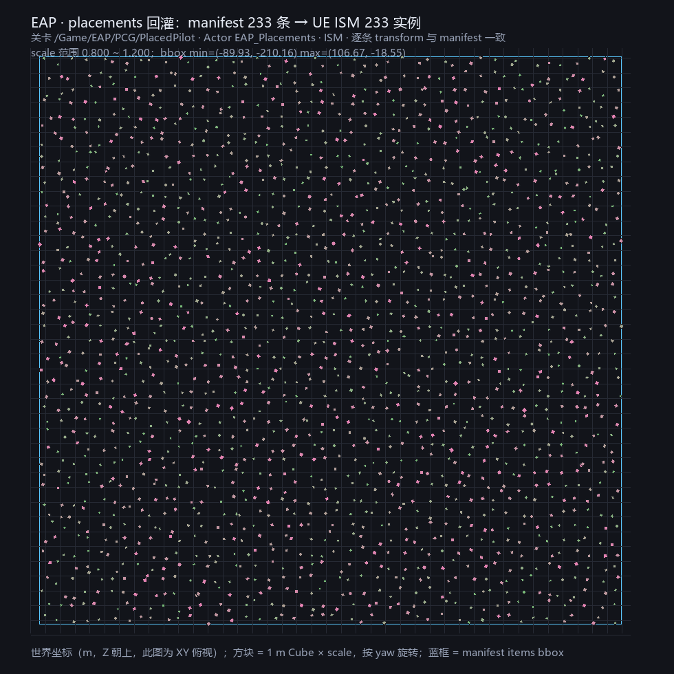
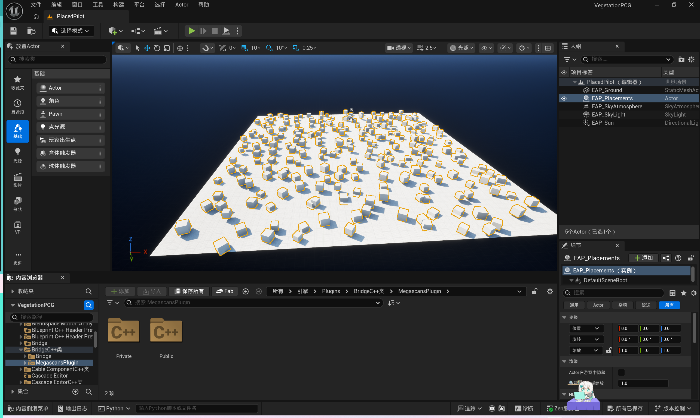
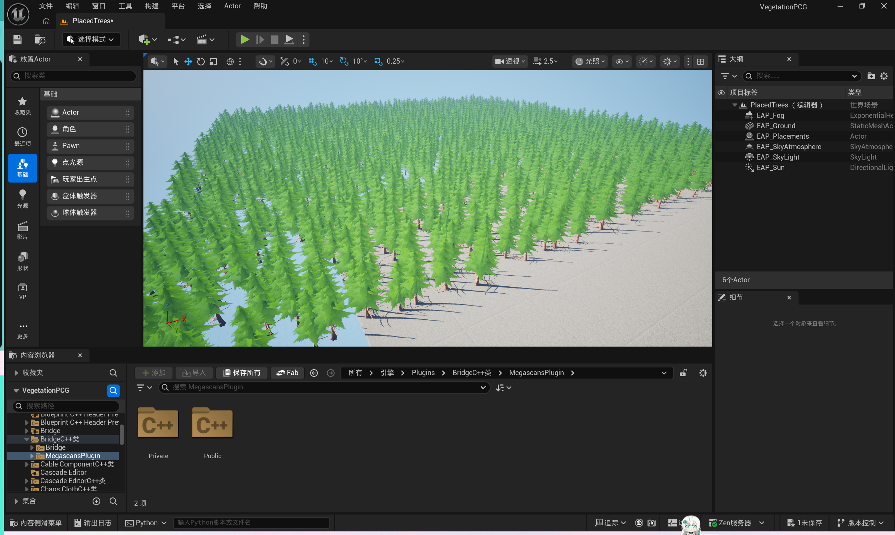

# 多引擎资产管线系统 · Engine-Agnostic Asset Pipeline

> 项目代号：`Engine-Agnostic Pipeline`（下称 EAP）
> 定位：前端 PCG + AIGC 生成 → Python 中台（格式中转 + 合规审查）→ UE5 / Unity 双端消费。
> **当前进度：阶段一（manifest 标准 + 双端消费端模板）+ Layer1 数据出口 + 地块扩到 200×200 m（1892 实例）+ placements 落位（回灌成 UE ISM）+ 换真实树 glb（1892 棵树端到端跑通）**。

## 一、这个项目在作品集里的位置（先读这段）

| 问题 | 结论 |
|---|---|
| 和 NO.01（V3 资产智能管线）什么关系 | **同一条线的下一代**，不是新项目：NO.01 是"单引擎 + 规则/AI 分类"，EAP 是"跨引擎 + PCG 生成 + 合规拦截"。网站**不新增第 10 张卡**（基线审刚要求精简到 5 卡 + 1 横排），改为 NO.01 卡内的版本演进叙事 |
| 补的是哪个缺口 | 四家 AI 基线审一致排第 1 的 **PCG 资格级缺口**（Layer 1），顺带补 ①引擎内工具（Layer 4）与 ⑤取舍沟通（跨引擎架构决策） |
| 不做什么 | 不做 Layer 5 的 VFX/HLOD（加分项，不是资格项）；Unity 端只做最小可验证（材质 + Prefab + Collider），不做 Unity 全套工具 |

## 二、目录

```
Engine-Agnostic Pipeline/
├─ README.md                      ← 本文件
├─ docs/
│  ├─ manifest-spec.md            ← manifest 字段规范（v1.1）+ 引擎映射表 + 坑
│  ├─ phase1-acceptance.md        ← 验收：阶段一 6 条 + Layer1 链路 11 条
│  ├─ tree_asset_requirements.md   ← 树资产采集要求（给采集会话的硬门槛）
│  ├─ pcg_forest_pilot.json       ← Layer1 导出证据：10 节点图参数 + 1892 条散点（cm）
│  ├─ placed_pilot.json           ← 引擎 Cube 落位证据：1892 条落成 UE ISM + 读回 transform
│  ├─ placed_tree.json            ← 真实树落位证据（同上格式，网格换成 conifer.glb）
│  └─ placed_verify.json          ← 新进程重载关卡读回证据（证明持久化）
├─ schemas/
│  ├─ manifest.schema.json        ← JSON Schema（v1.1：placements / engine_native）
│  ├─ manifest.example.json       ← 两个资产的完整示例（v1.0 结构，v1.1 向后兼容）
│  └─ pcg_manifest.json           ← 由散点生成的 manifest v1.1（1 资产 + 1892 实例）
├─ ue/Content/Python/
│  ├─ consume_manifest.py         ← UE5 消费端（读 manifest → 母材质/MIC → 贴图 → 碰撞 → placements 统计）
│  ├─ pcg_export.py               ← Layer1 出口：PCG 图参数 + 生成实例 → 散点 JSON（只读）
│  └─ place_manifest.py           ← Layer1 回灌：placements → UE ISM 实例（落位；glb 走无头 Interchange 导入）
├─ unity/Editor/
│  └─ ManifestImporter.cs         ← Unity 编辑端（读同一份 manifest → Material → Prefab → Collider）
├─ tools/
│  ├─ validate_manifest.py        ← 中台侧轻量校验（结构 + 2 的幂 + 通道 + 单位 + v1.1 placements）
│  ├─ pcg_to_manifest.py          ← 散点 JSON → manifest v1.1（cm→m，1 网格 = 1 asset + N placements）
│  ├─ tree_to_manifest.py         ← 真实树 glb + 散点 → manifest v1.1（双端；不信任 sidecar，自己解析 GLB 复算）
│  ├─ run_pcg_chain.py            ← 一条命令跑完整条 Layer1 链（7 步 / 4 次无头 UE）+ 9 条断言（--tree 时 11 条）
│  ├─ draw_placements.py          ← 从读回 transform 画俯视图（方块 / 树冠圆两种标记）
│  ├─ test_validator.py           ← 校验器 9 条负例（拦截 9/9）
│  └─ test_gui_smoke.py           ← GUI 冒烟（12/12）
└─ assets/raw/trees/              ← 真实树资产（conifer / broadleaf .glb + source_assets.json 许可证凭证；模型不入库）
```

## 三、阶段一怎么跑

**1. 造一份 manifest**

```bash
python tools/validate_manifest.py schemas/manifest.example.json
# 期望：OK assets=2 warnings=0 errors=0
```

**2. UE5 端（编辑器内 Python，先 dry-run）**

```python
# 编辑器菜单 Tools → Execute Python Script，或在 Output Log 的 Cmd 里：
import sys; sys.path.append(r"<repo>/ue/Content/Python")
import consume_manifest
consume_manifest.run(r"<repo>/schemas/manifest.example.json", dry_run=True)   # 只打印将做什么
consume_manifest.run(r"<repo>/schemas/manifest.example.json", dry_run=False)  # 真跑
```

**3. Unity 端**

```
菜单 Tools → EAP → Import Manifest…  → 选同一份 manifest.example.json
（或命令行：Unity -batchmode -executeMethod EAP.ManifestImporter.ImportFromArgs -eapManifest <path>）
```

**4. 界面（阶段一 GUI 壳）**

```bash
python run.py        # 或 python -m gui.app；暗色三栏 + 拖放区 + Toast
```

## 三之二、Layer 1 数据出口 + 扩地块（v1.1，一条命令）

**背景**：Layer 1 原先是 2026-10 的 UE PCG 手工试点（`D:\UE_Projects\VegetationPCG`，UE 5.7，
`/Game/PCG_ForestScatter`，用 `/Engine/BasicShapes/Cube` 方盒子替树，19 个实例）。
2026-11-22 分两步：① 数据出口接到中台（密度 `0.01 → 0.1`，实例 **19 → 233**）；
② **地块扩到 200×200 m**（密度 `0.1 → 0.05`，实例 **233 → 1892**，名义 2000、实际 1892 = 94.6%）。

```
UE PCG 图（10 节点：GetLandscapeData → SurfaceSampler → TransformPoints → StaticMeshSpawner
           + 5 个用户参数节点 + 1 个 AttributeMathsOp）
   ↓ pcg_export.py           只读：图参数 + 1892 条实例 transform（uu = cm）
docs/pcg_forest_pilot.json    （1189 KB）
   ↓ pcg_to_manifest.py      cm→m；1 个网格 = 1 个 asset + placements[1892]（不为每实例造资产）
schemas/pcg_manifest.json    （manifest v1.1，626 KB）
   ↓ validate_manifest.py    errors=0
   ↓ consume_manifest.run(dry_run=True)   读到 placements，统计 1892
```

```bash
python tools/run_pcg_chain.py --expect-span-m 200    # 四次无头 UE（各约 13-15s）+ 两次纯 Python；7 步 9 条断言
# 期望末行：CHAIN PASS points=1892 assets=1 placements=1892
```

**改体积 / 密度（必须在真实编辑器里做）**——两个坑都是 2026-11-22 实测：

1. **无头不能重生成 PCG**：`PCGComponent.generate()` 在 `-unattended -nullrhi` 下报
   `Internal Error - ObjectInstance is null!`；带 RHI 的 `-unattended` 也生成不了（233 → 233）。
2. **旧 PCG 组件可能和 actor 脱钩**：这个工程原 `PCG Component` 处于 `generated=False`、
   Details 里 `图 None / PCG组件 None` 的坏状态，`generate()` 和 Details 的生成按钮都无效（点了没反应）。
   解法：**新建一个 PCGVolume → `set_graph()` 挂同一张图 → `generate(True)`**，一次生成 1892 个实例。

体积按米换算：brush 基准 2 m，原 actor scale `25/25/10` = 50×50×20 m；放大到 200 m 用
`actor scale 99.98 / 97.675 / 10`（**Z 保持 20 m**——把 Z 也非均匀放大 150 倍会让实例被拉长、沉到地面以下，
2026-11-22 踩过）。落位 bbox 实测 **196.6 × 191.6 m**（边缘点没采到，< 200 m 属正常）。

导出文件同时是**图参数的原始证据**（`graph.nodes[*].props`）：`points_per_squared_meter=0.05`、
`point_extents=[50,50,50]`、`point_steepness=1.0`、`absolute_rotation=True`、`offset_min/max=±[100,100,50]`、
`scale_min/max=[0.8]/[1.2]`、`uniform_scale=True`、`seed=-1506168781`、`StaticMeshSpawner` 网格 `/Engine/BasicShapes/Cube`。
这比截图更可核对：面试被问"你图里到底怎么配的"，直接翻 JSON。

> **关于数量**：PCG 体积实测 **200×200 m（39997.7 m²）**，0.05 点/m² → 名义 2000、实际 **1892**（94.6%）；
> 上一轮 50×50 m + 0.1 → 名义 250、实际 233（93%）；最早 0.01 → 名义 25、实际 19（76%）。
> 偏差都来自网格量化 + `looseness 0.8`，不是丢数据。

## 三之三、placements 落位（回灌）：manifest → UE ISM 实例

前面三之二证明"PCG 生成能变成 manifest"；这一格证明**反过来也能**：拿 manifest 里的 `placements[1892]`
在 UE 里真的落成 1892 个 ISM 实例，并验证坐标/旋转/缩放一条不差。

```
schemas/pcg_manifest.json（placements 1892 条，m / deg）
   ↓ place_manifest.place()     清空 → 逐条 add_instances(世界坐标) → clear/重建可重复跑
/Game/EAP/PCG/PlacedPilot        专用关卡：1 Actor + 1 InstancedStaticMeshComponent + 1892 实例
   ↓ place_manifest.verify()    新进程重载关卡 → 读回 1892 条 transform → docs/placed_verify.json
```



> 上图由 `tools/draw_placements.py` 从 `docs/placed_pilot.json` 的读回 transform 画（俯视 XY、方块按 yaw 旋转并乘 scale），不是手绘示意图。



> 上图：`/Game/EAP/PCG/PlacedPilot` 引擎内实拍（2026-11-22 16:24）。大纲 5 个 Actor：
> `EAP_Placements`（ISM 1892 实例）、`EAP_Ground`、`EAP_Sun`（Movable）、`EAP_SkyAtmosphere`、`EAP_SkyLight`；
> 机器可读状态见 `docs/placed_level_actors.json`（无头重载复核：5 actors / 1892 instances）。

实现要点（踩过的坑，都写进代码注释了）：

- **给关卡里的 Actor 加组件不能用 `unreal.new_object`**：能建出来但不在 `OwnedComponents` 里，
  存关卡后组件被丢掉（实测：3 条实例落盘后读回 0 条）。必须走
  `SubobjectDataSubsystem.add_new_subobject(AddNewSubobjectParams)`——就是 Details 面板 "Add Component" 的 Python 路径。
- 关卡里 **Actor 自己会存**，所以"先落位再读回"要**新进程**验证，否则验证的是内存里的对象不是存档。
- `Transform.rotation` 是 **Quat**，`FRotator` 要从 `quat.rotator()` 取；`unreal.Rotator(pitch=, yaw=, roll=)` 用关键字，
  位置参数顺序是 `(roll, pitch, yaw)`（`Rotator(10,20,30)` 实际是 roll=10,pitch=20,yaw=30）。
- manifest 的 `r` 沿用导出端的 `[roll, pitch, yaw]`（来自 `FRotator.euler()` 的 x/y/z），落位端按同一顺序还原。

```bash
# 单独跑（不用整条链）：
#   UE 里 -ExecutePythonScript=ue/Content/Python/place_manifest.py        （默认 place）
#   EAP_PLACE_MODE=verify 再跑一次                                        （验证）
```

**已知边界**：只处理单资产 manifest（现在就是 1 个 Cube 网格）；只落 transform（材质/碰撞/LOD 走 manifest 其它字段，
本阶段不落）；落位关卡是专用关卡，不碰你的 `/Game/Untitled` 试点现场。

## 三之四、换真实树资产（glb）：管线第一次吃"真东西"

前三节的所有数字都建立在 `/Engine/BasicShapes/Cube` 上，Unity 端还是跳过的（引擎网格没有 glb）。
这一节把网格换成真实的 **glTF 2.0 树资产**，双端第一次都有文件型目标。

```
assets/raw/trees/conifer.glb（Poly Pizza / Quaternius，CC0，3 370 面，10.236 m，贴图内嵌）
   ↓ tree_to_manifest.py   自己解析 GLB 二进制复算 bbox/面数/本证，再和 sidecar 对账（不信上游）
schemas/tree_manifest.json   manifest v1.1：model.source=file + 双端 engineTargets + placements[1892]
   ↓ validate_manifest.py    errors=0
   ↓ place_manifest.place() 无头 Interchange 导入 glb → StaticMesh → ISM 落 1892 个实例
/Game/EAP/PCG/PlacedTrees   专用关卡：1 Actor + 1 ISM（1892 棵 conifer）
   ↓ place_manifest.verify() 新进程重载读回 → docs/placed_tree_verify.json
```

```bash
python tools/run_pcg_chain.py --tree --expect-span-m 200    # 四次无头 UE + 两次纯 Python；11 条断言
# 期望末行：CHAIN PASS points=1892 assets=1 placements=1892
```


> 上图仍是读回的**真实 transform**（1892 条），只是标记换成树冠圆（半径按 glb bbox X/2 = 2.90 m × scale）。



> 上图：`/Game/EAP/PCG/PlacedTrees` 引擎内实拍（2026-11-22 18:07，用户手操补灯光后）。
> 大纲 6 个 Actor：`EAP_Placements`（ISM 1892 棵）、`EAP_Ground`、`EAP_Sun`、`EAP_SkyLight`、
> `EAP_SkyAtmosphere`、`EAP_Fog`。树根落地、投影方向一致、地块边缘可见。
> **画面偏荧光绿、树皮没层次**——这正是下节列的材质缺陷（`metallicFactor 0.4` + 叶子 `BLEND`）的直接后果。

**资产体检（我独立解析 GLB，不采信 `source_assets.json` 的自述）**

| 项 | conifer | broadleaf |
|---|---|---|
| 许可 / 来源 | CC0-1.0 · Quaternius（Poly Pizza） | 同 |
| 树高 | 10.2364 m | 9.4252 m |
| 三角面 | 3 370（glTF 索引复算，2 个 primitive：2160 + 1210） | 3 505 |
| 原点 | bbox min y = 0.0000（树干底部已归一化） | 同 |
| 贴图 | 3 张 1024² 内嵌，无外部 uri | 同 |
| 材质 | 树皮 OPAQUE + 叶 BLEND，均 metallicFactor 0.4 | 同 |

**三个实测发现（都写进代码注释了）**

1. **无头能导 glTF**：UE 5.7 `-nullrhi -unattended` 下 Interchange glTF 导入可用，单棵 0.4~1.2 s，
   落点固定为 `<destPath>/<文件名>/StaticMeshes/<文件名>`，材质/贴图由 Interchange 自动生成。
   （这条以前不敢保证，先单独跑了一次探针才敢接进链路。）
2. **轴心补偿 0.5 m 必须做**：散点的 `t` 是引擎 Cube 的**中心**，树的轴心在**树根底部**；照抄 `t` 会让
   1892 棵树整体悬空半米。manifest 里 `pivot.zOffsetM = 0.5` 记录这次换算，落位端按底面落。
3. **Nanite 默认开着**：导入后 `mesh.get_num_triangles(0)` 报 **1 414**（源 3 370）、broadleaf 报
   2 354（源 3 505）——返回的是 Nanite 的 fallback 简化网格，不是源数据。**验收表用 glTF 侧的 3 370**，
   UE 侧的 1 414 当作"Nanite fallback"记录，别混着引用。
4. **导入的材质缺用法标记**（用户实拍时 `地图检测` 报出）：`/InterchangeAssets/gltf/M_Default` 与
   `/Game/EAP/Trees/conifer/Materials/Bark_NormalTree` 都报"缺失使用标记 `bUsedWithNanite` /
   `bUsedWithInstancedStaticMeshes`，材质资产未重新保存时**编辑器外运行时可能渲染不出来**"。
   编辑器里没事（实拍正常），但这是打包前的必修项——和材质规范化一起做。

**这一节明确没做的**（写进第五节）：叶子 `BLEND` 改 `MASKED`、`metallicFactor 0.4 → 0`、补 LOD、双树种混排、
Unity 端实跑。当前只证明"管线能连续吃真资产"，不主张画面质量。

## 四、阶段一验收（6 条，逐条可判）

| # | 判据 | 判法 |
|:--:|---|---|
| 1 | 同一份 manifest 双端都能读 | UE 与 Unity 各跑一次，均无报错，日志里打印资产数一致 |
| 2 | UE 端能自动建出母材质 + 材质实例并连好贴图 | 材质实例里 BaseColor/Normal/ORM 三个参数有值，指向正确贴图 |
| 3 | Unity 端能自动建出 Material 并映射贴图 | `_BaseMap` / `_BumpMap` / `_MetallicGlossMap` 三个槽有值 |
| 4 | 法线贴图不吃 sRGB | UE 里 `srgb=False`、Unity 里 `TextureImporterType.NormalMap`，各留一张 Inspector 截图 |
| 5 | 2 的幂 / 通道完整性不通过时**被拦住** | 故意把一张贴图改成 1000×1000，跑校验脚本必须报 error 并非零退出 |
| 6 | 同一份 manifest 在两端产出的资产名、路径、尺寸一致 | 对照日志：资产名 / 目标路径 / 包围盒三列完全一致 |

> 没截图、没日志、没退出码 = 没过。这条照搬项目验收标准。

### 四之二、Layer 1 链路验收（9 + 2 条，`python tools/run_pcg_chain.py [--tree]` 自动判）

| # | 判据 | 实测（2026-11-22 17:33 / 18:0x） |
|:--:|---|---|
| 1 | 导出散点数 == 图生成实例数 | 1892 == 1892 |
| 2 | 导出散点数 == ISM 实例数之和 | 1892 == 1892 |
| 3 | 导出散点数 == `manifest.placements.count` | 1892 == 1892 |
| 4 | `manifest.placements` == UE 消费端 dry_run 报告里的 placements | 1892 == 1892 |
| 5 | `manifest.placements` == 落位实例数（UE ISM） | 1892 == 1892 |
| 6 | 新进程重载关卡读回实例数 == placements | 1892 == 1892（持久化，不是内存假象） |
| 7 | 落位实例 bbox == manifest items bbox | 误差 0.0000 m（阈值 1 cm） |
| 8 | 落位实例逐条 transform == manifest items | 0/1892 不匹配（阈值 1 cm / 0.05°） |
| 9 | 落位地块跨度 == 200 m（±15%） | X=196.6 m / Y=191.6 m |
| 10 | `--tree`：落位网格是树资产（非引擎 Cube） | `/Game/EAP/Trees/conifer/StaticMeshes/conifer.conifer` |
| 11 | `--tree`：UE 侧树高 == glTF 树高（<5 cm） | UE=10.236 m / glTF=10.236 m |

产物：`docs/pcg_forest_pilot.json`（1189 KB，图参数 + 1892 条散点）、`schemas/pcg_manifest.json`（626 KB）、
`docs/placed_pilot.json`（436 KB）、`docs/placed_verify.json`（435 KB）；
换树链路另有 `schemas/tree_manifest.json`、`docs/placed_tree.json`、`docs/placed_tree_verify.json`。

## 五、阶段一未覆盖（写在明处，别在面试里含糊）

- **轴心（Pivot）**：UE Python API **没有**直接改 StaticMesh 轴心的接口。本仓库的做法是把 `pivot.mode` + `pivot.offsetM` 写进 manifest，在**导出端**（DCC/glTF 节点变换）执行；消费端只做校验与告警。Unity 端同理由 Prefab 根节点补偿。
- **Unity 的粗糙度通道**：URP 的 `_MetallicGlossMap` 是 R=Metallic、A=Smoothness，**Smoothness = 1 − Roughness**。manifest 里显式写 `channelPacking`，转换在消费端完成（不在导出端预乘），避免两端各算一遍。
- **贴图压缩格式**：UE 的 `TC_Normalmap` / Unity 的 crunch 等属于平台设置，本阶段只写进 manifest 的期望值，不保证跨机器一致。
- **LOD/HLOD**：manifest 里记录 `lods[]`，本阶段只校验不生成。
- **placements 落位只落 transform（v1.1）**：`place_manifest.py` 把 1892 条落成 ISM 实例并验证坐标/旋转/缩放，
  但 manifest 里的材质、碰撞、LOD 字段本阶段不落；落位只支持"单资产 manifest"（当前就是 1 个 Cube 网格）。
- **给关卡 Actor 加组件的坑（v1.1）**：`unreal.new_object(InstancedStaticMeshComponent, outer=actor)` 建出来的组件
  不在 `OwnedComponents`，存关卡后会被丢弃；必须用 `SubobjectDataSubsystem.add_new_subobject`（Details→Add Component 的 API）。
- **PCG 点级 metadata 读不到（v1.1）**：`get_generated_graph_output()` 能拿到 `PCGDataCollection`（tagged=1），但点级 attribute（密度/seed）没有暴露的 Python 访问器。所以出口以**实例 transform** 为准——实例是最终结果，反而更可信。
- **Unity 端跳过引擎内置网格（v1.1）**：`model.source=engine`（如 `/Engine/BasicShapes/Cube`）没有 glb，Unity 不适用；只有文件型资产走双端。
- **无头导出依赖本机路径（v1.1）**：`run_pcg_chain.py --ue/--project` 可覆盖，默认 `C:\Program Files\Epic Games\UE_5.7` + `D:\UE_Projects\VegetationPCG`。
- **树资产材质没规范化（v1.2）**：glTF 的叶子材质是 `BLEND`（1892 个实例会有排序/开销问题，正式出图应改 `MASKED`）、
  树皮/树叶 `metallicFactor = 0.4`（转换器默认值，UE 里偏塑料感，实拍已确认画面荧光绿）。目前只在 manifest 的
  `checks`/日志里告警，**没有自动改材质**。
- **导入材质缺用法标记（v1.2）**：Interchange 生成的 `M_Default` 与树材质缺 `bUsedWithNanite` /
  `bUsedWithInstancedStaticMeshes`，编辑器内渲染正常，但打包后可能丢材质。修法：材质规范化单元里补 usage flag + 重存。
- **UE 侧三角面数要看清口径（v1.2）**：glTF 源数据 conifer 3 370 面，导入 UE 后 `get_num_triangles(0)` 报 1 414
  （broadleaf 3 505 → 2 354）——返回的是 **Nanite fallback** 简化网格。引用数字时写明是哪一侧。
- **树资产没有 LOD（v1.2）**：两棵树都只有 1 个 LOD（3 370 / 3 505 面，符合"低模无 LOD"门槛），
  1892 棵全量无 LOD 只能靠 Nanite 与实例剔除撑；LOD 链是下一项工作。
- **只有单树种全量替换（v1.2）**：本链路一次只落一个网格（`place_manifest` 单资产），阔叶树还没接进落位；
  双树种混排需要把落位端扩成多资产 / 多 ISM。
- **落位关卡不带灯光与地面（v1.2）**：`PlacedTrees` 由无头新建，只有 `EAP_Placements`。灯光/天空/地面
  （`place_manifest.stage()`）**只能在真实编辑器里跑**——无头加 SkyAtmosphere/SkyLight 会
  `EXCEPTION_INT_DIVIDE_BY_ZERO` 崩掉（2026-11-22 实测）。
- **Unity 端还没实跑树资产（v1.2）**：`tree_manifest.json` 已经有 `engineTargets.Unity`（`Assets/EAP/Trees`），
  但 Unity 侧导入尚未执行（计划 2026-11-25 跑空工程验证）。

## 六、下一步（阶段二/三）

- 阶段二 · 树资产规范化：叶子 `BLEND → MASKED`、`metallic 0.4 → 0`、补 LOD 链（LOD1 ≤5 千 / LOD2 ≤1.5 千）；
  再把阔叶树接进落位做双树种混排（需要落位端支持多资产/多 ISM）
- 阶段二 · Unity 端实跑同一份 `tree_manifest.json`（glb + placements 双端一致性）
- 阶段二 · 落位扩展到材质/碰撞/LOD：现在只落 transform，manifest 里其它字段还没在 UE 侧生效
- 阶段二 · GUI 接 ComfyUI 客户端（GUI 阶段二的 QThread 异步 + 进度回填）
- 阶段三：`trimesh` + `numpy` 坐标转换（Y-up↔Z-up、cm↔m）与合规拦截（与 `tools/validate_manifest.py` 合并）
- 阶段四（作品集包装）：量化三段时间——**导入耗时 / 材质实例化耗时 / 碰撞生成耗时**，各自单测 20 个资产取中位数；把"10 分钟/个 → X 秒/个"写成三段可复现的表
